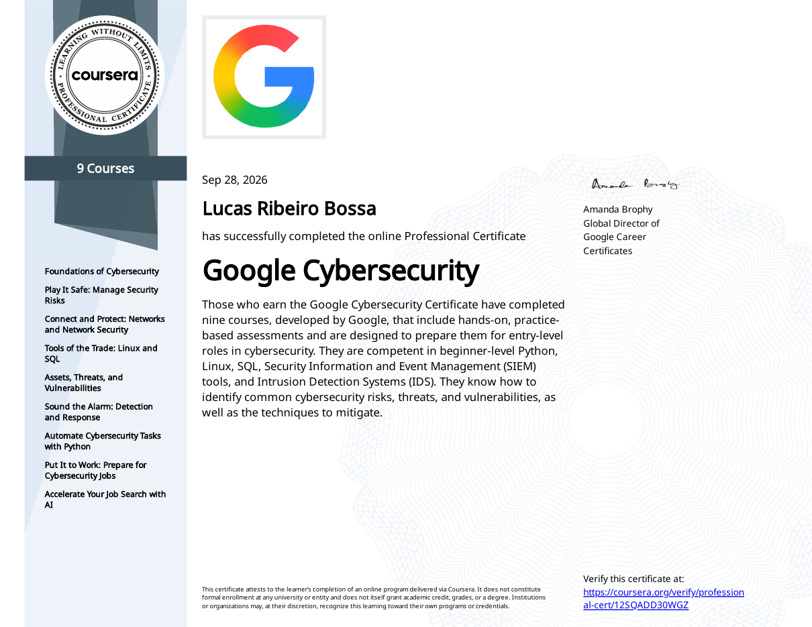
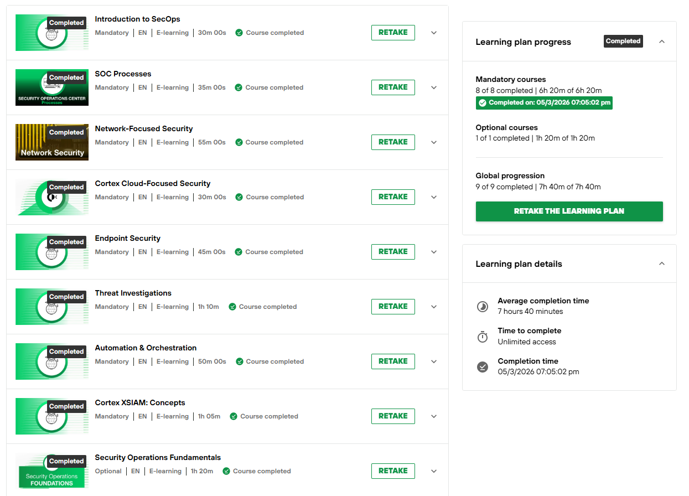

# Certifications and Training

| Certification / Training | Status |
|---|---|
| Google Cybersecurity Professional Certificate (Coursera) | Completed September 2026 |
| Palo Alto Networks Cortex Foundations | Completed May 2026 |
| CompTIA Security+ (SY0-701) | In progress |

## Google Cybersecurity Professional Certificate

9 course program covering security frameworks and controls, networking, Linux, SQL, Python, SIEM tools, IDS, and incident detection and response. The coursework write-ups in this portfolio are from this program: [coursework](../coursework/)

[Verify on Coursera](https://coursera.org/verify/professional-cert/12SQADD30WGZ) | [Certificate PDF](google-cybersecurity-certificate.pdf)

## Palo Alto Networks Cortex Foundations

All 9 courses in the learning plan, about 7 hours 40 minutes: SecOps, SOC processes, network, cloud and endpoint security, threat investigations, automation and orchestration, and Cortex XSIAM.

