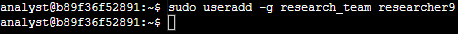
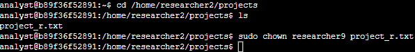
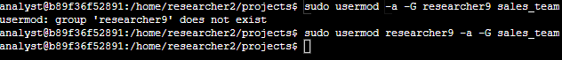
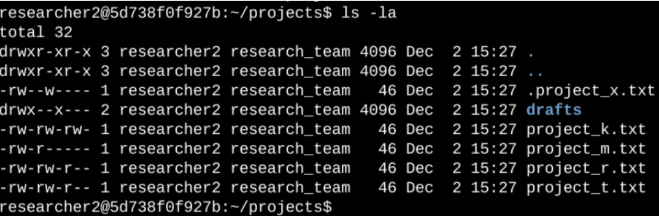
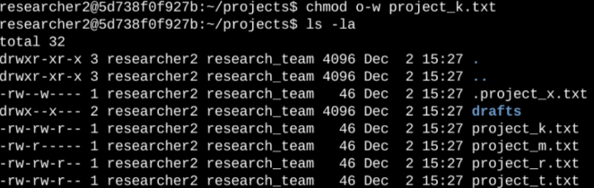
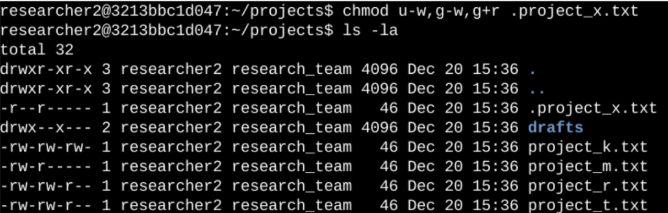
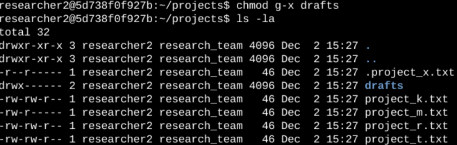

# Linux User and Permission Management

*Google Cybersecurity Certificate coursework*

Two labs that go together: managing a user's access through their time at a company, and locking down file and directory permissions so they match what the organization wants. This is least privilege done from the command line.

**Commands used:** `useradd`, `usermod`, `userdel`, `chown`, `chmod`, `ls -la`

## Part 1: Managing a user from hire to exit

A new employee, `researcher9`, joins the research team. I had to add them, give them ownership of a file, add them to a second team when their role changed, and remove them when they left.

### Add the new user

```
sudo useradd -g research_team researcher9
```

`sudo` gives me root privileges, `useradd` creates the user, and `-g` sets `research_team` as their primary group. No errors came back so the user was created.



### Give them ownership of a file

researcher9 needed to take over `project_r.txt`, which was owned by someone else. I moved to the folder, checked it was the right one with `ls`, then changed the owner:

```
cd /home/researcher2/projects
ls
sudo chown researcher9 project_r.txt
```



### Add them to a secondary group

Their role changed and they're now doing both research and sales, so they needed to be added to `sales_team` without changing their primary group.

```
sudo usermod researcher9 -a -G sales_team
```

`-a` means append (add to a group without removing the others) and `-G` means it's a secondary group, not the primary one.

My first try I had the order wrong (`usermod -a -G researcher9 sales_team`). `-G` takes the group name right after it, so Linux thought `researcher9` was the group and gave me `group 'researcher9' does not exist`. Fixed the order and it worked.



### Remove the user when they leave

```
sudo userdel researcher9
```

No error came back. I double checked with `cut -d: -f1 /etc/passwd`, which lists all users, and researcher9 was gone.


## Part 2: Setting file and directory permissions

The research team's `projects` directory had permissions that didn't match what the organization wanted. I had to check them and fix them.

### Check the current permissions

```
ls -la
```

`-la` shows everything, including hidden files. There was a hidden file `.project_x.txt`, a `drafts` directory and 5 project files.



### Reading the permission string

The 10 characters at the start of each line show who can do what:

- 1st character: `d` for a directory, `-` for a file
- 2nd to 4th: what the **user** (owner) can do
- 5th to 7th: what the **group** can do
- 8th to 10th: what **others** can do
- `r` = read, `w` = write, `x` = execute, `-` = no permission

Example, `-rw-rw-r--` on `project_r.txt`: it's a file, the user and group can read and write, others can only read, and nobody can execute it.

### Remove write access for others

The organization didn't want "others" writing to any files. `project_k.txt` was the only one where they could.

```
chmod o-w project_k.txt
```

`o` is others and `-w` takes away write. Ran `ls -la` again and it went from `-rw-rw-rw-` to `-rw-rw-r--`.



### Fix the hidden file

Nobody should be able to write to `.project_x.txt`, but the user and group should be able to read it.

```
chmod u-w,g-w,g+r .project_x.txt
```

User and group lose write, group gets read. It went from `-rw--w----` to `-r--r-----`. There can't be any spaces between the comma separated parts or Linux reads them as file names.



### Lock down the drafts directory

Only `researcher2` should have access to `drafts`. The group still had execute, which on a directory means they can get into it.

```
chmod g-x drafts
```

It went from `drwx--x---` to `drwx------`. researcher2 already had full access so nothing else needed to change.



## Takeaway

Managing who has access is a big part of security. Adding, changing and removing users and making sure permissions only give people what they need is how you keep least privilege in place, and it's the kind of thing that gets missed when someone changes roles or leaves the company.
