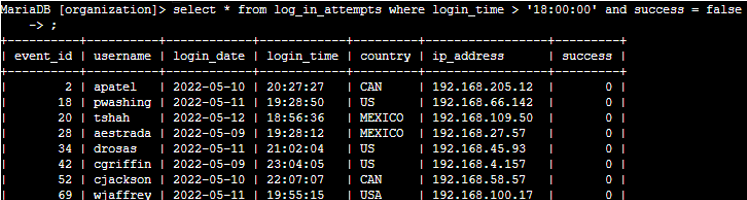
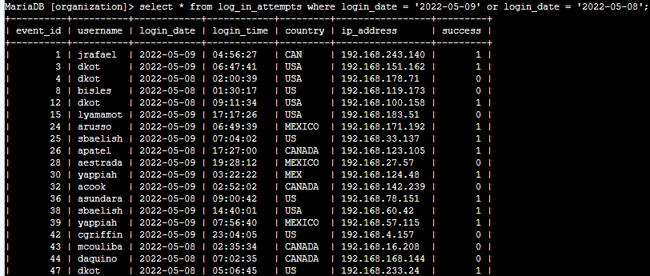
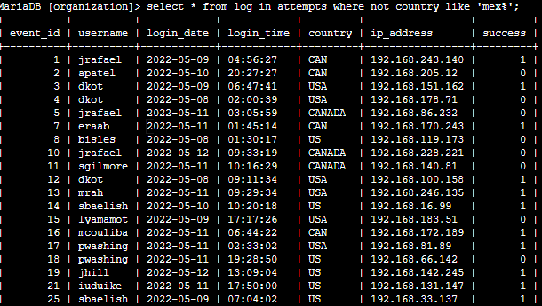
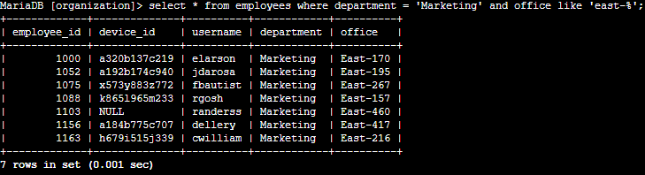
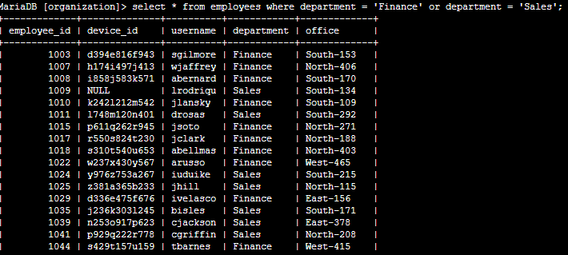
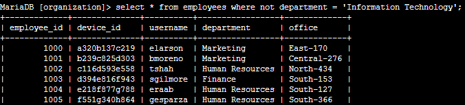
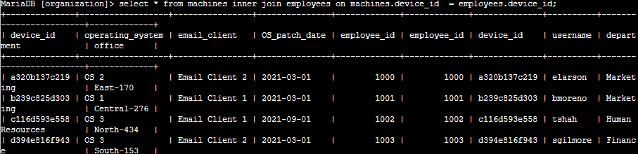
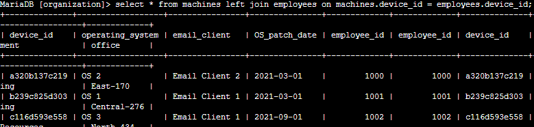
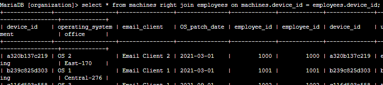
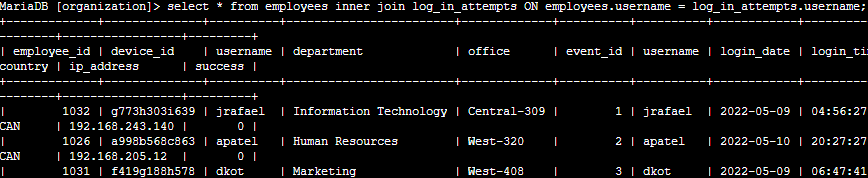

# SQL Security Investigations

*Google Cybersecurity Certificate coursework*

Two labs where I used SQL to pull data for security investigations from an organization's database (MariaDB). The first one uses filters to find suspicious login attempts and specific groups of employees. The second uses joins to connect employees, their machines and their login attempts.

**Tables used:** `log_in_attempts`, `employees`, `machines`

**SQL used:** `WHERE`, `AND`, `OR`, `NOT`, `LIKE`, `INNER JOIN`, `LEFT JOIN`, `RIGHT JOIN`

## Part 1: Filtering for suspicious activity

### Failed logins after business hours

There was a possible issue with failed logins after hours (after 18:00). I needed only the attempts that were after 18:00 **and** failed.

```sql
SELECT *
FROM log_in_attempts
WHERE login_time > '18:00:00' AND success = FALSE;
```



### Logins on specific dates

The team was investigating a suspicious event on 2022-05-09, so I pulled every login from that day and the day before.

```sql
SELECT *
FROM log_in_attempts
WHERE login_date = '2022-05-09' OR login_date = '2022-05-08';
```

75 results came back.



### Logins from outside Mexico

There were suspicious logins coming from outside Mexico. The catch here is the country column isn't consistent. Mexico shows up as both `MEX` and `MEXICO` (same with `US`/`USA` and `CAN`/`CANADA`). So instead of matching one exact value I used `LIKE` with a wildcard so it catches both.

```sql
SELECT *
FROM log_in_attempts
WHERE NOT country LIKE 'MEX%';
```

144 results came back.



### Marketing employees in the East building

IT needed to update machines for Marketing employees in the East building. Offices are named like `East-170`, so `LIKE 'East-%'` gets all of them.

```sql
SELECT *
FROM employees
WHERE department = 'Marketing' AND office LIKE 'East-%';
```

7 employees came back. One of them, randerss, has `NULL` for device_id, meaning no machine is assigned to them.



### Finance and Sales employees

A different update was needed for everyone in Finance or Sales.

```sql
SELECT *
FROM employees
WHERE department = 'Finance' OR department = 'Sales';
```



### Everyone not in IT

IT's machines were already updated, so I needed everyone else.

```sql
SELECT *
FROM employees
WHERE NOT department = 'Information Technology';
```

161 results came back.



## Part 2: Joining tables for an investigation

Some machines were compromised and I needed to connect employees to their machines and login activity. Both `employees` and `machines` have a `device_id` column, and `employees` and `log_in_attempts` both have `username`, so those are what I joined on.

### Which employee uses which machine (INNER JOIN)

```sql
SELECT *
FROM machines
INNER JOIN employees ON machines.device_id = employees.device_id;
```

An inner join only returns rows that match in both tables, so this gives every machine that has an employee assigned.



### All machines, even unassigned ones (LEFT JOIN)

```sql
SELECT *
FROM machines
LEFT JOIN employees ON machines.device_id = employees.device_id;
```

A left join keeps every row from the first table (`machines`) even if there's no match. If a machine isn't assigned to anyone, the employee columns come back `NULL`. Useful for finding machines nobody is responsible for.



### All employees, even without a machine (RIGHT JOIN)

```sql
SELECT *
FROM machines
RIGHT JOIN employees ON machines.device_id = employees.device_id;
```

A right join does the opposite and keeps every row from the second table (`employees`). Anyone without a machine shows `NULL` in the machine columns.



### Login attempts by employee (INNER JOIN)

```sql
SELECT *
FROM employees
INNER JOIN log_in_attempts ON employees.username = log_in_attempts.username;
```

This connects every login attempt to the employee who made it, with their department and office, so you can see who was logging in from where and whether it worked.



## Takeaway

A lot of SOC work is pulling the right data out of a big pile of logs. Filters narrow it down to what matters (failed, after hours, wrong country) and joins add context (who the user is, what machine they're on). Messy data like the country column is normal, so you have to look at what's actually in there before trusting a query.
