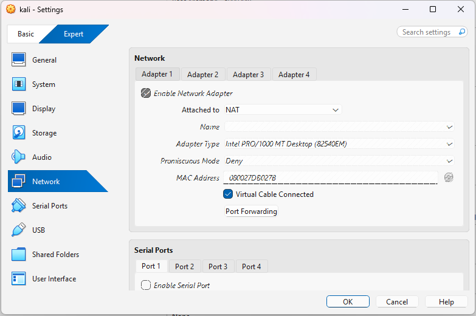
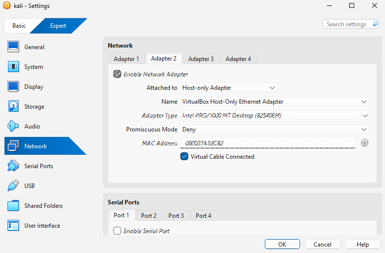
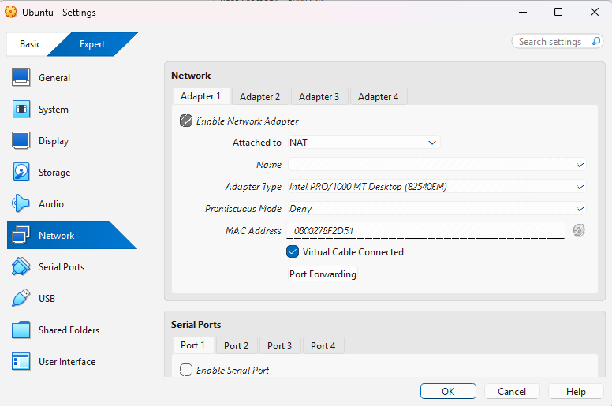
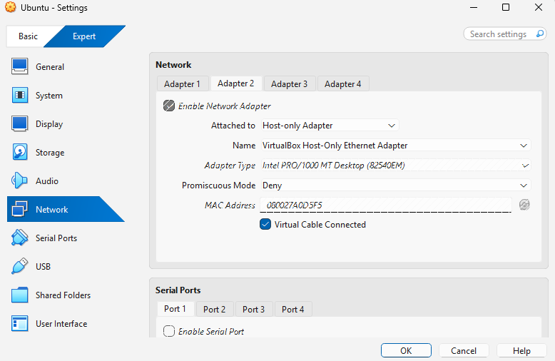
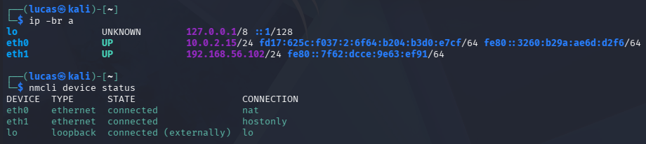
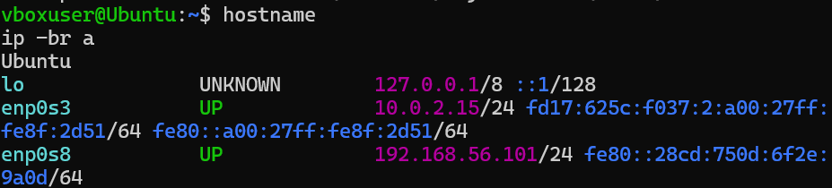
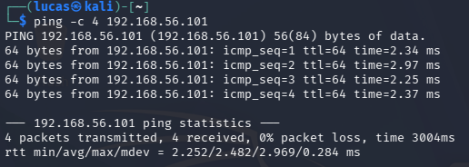
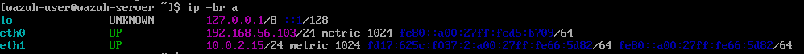
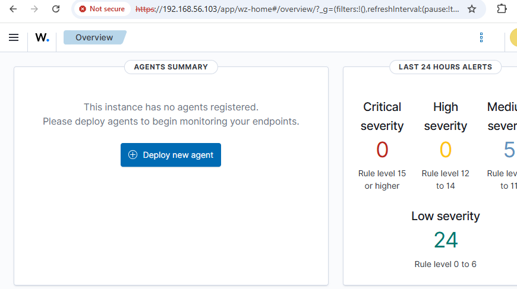
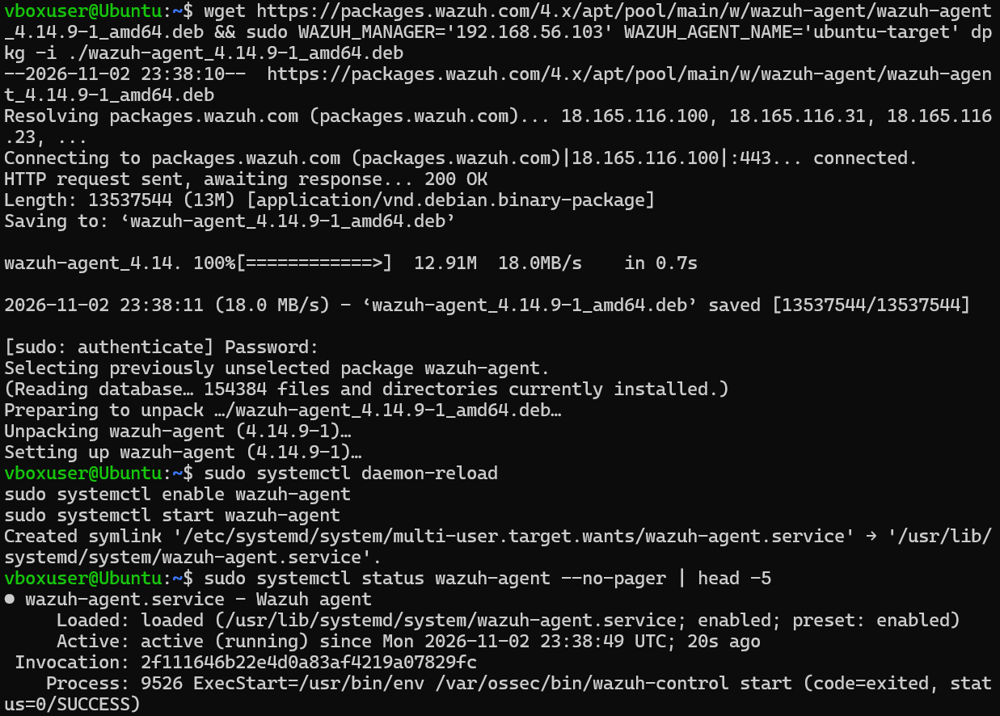

# Home Lab Setup

This is the home lab I use for my security projects. It runs on my Windows laptop in Oracle VirtualBox. Right now it's three VMs: Kali Linux as the attacker, Ubuntu as the target, and a Wazuh SIEM server watching Ubuntu. I plan on adding more to it over time.

Every project in this portfolio runs on this lab and links back here so I don't have to repeat the setup every time.

## What's in the lab

| Machine | OS | Role | Lab IP (host-only) | NAT IP |
|---|---|---|---|---|
| Kali | Kali Linux | Attacker / testing machine | 192.168.56.102 | 10.0.2.15 |
| Ubuntu | Ubuntu 26.04.1 LTS | Target, monitored by Wazuh | 192.168.56.101 | 10.0.2.15 |
| Wazuh | Amazon Linux 2023 (Wazuh 4.14.9 OVA) | SIEM server | 192.168.56.103 | 10.0.2.15 |
| Windows host | Windows | Admin access (SSH into the VMs, Wazuh dashboard in the browser) | 192.168.56.1 | N/A |

## Network setup

Each VM has two network adapters:

- **NAT:** gives the VM internet through the host so I can install updates and tools. VirtualBox gives each VM its own separate NAT, which is why all three show 10.0.2.15. They can't see each other on this network.
- **Host-only:** a private network between the VMs and my host. This is the lab network and all testing happens over it.

Keeping the testing on host-only means any attack traffic stays inside the lab and never touches my home network. Nothing outside my laptop can reach any of the VMs.

```
                       Windows host (192.168.56.1)
                                    |
        ----------------- host-only network 192.168.56.0/24 -----------------
              |                           |                           |
       Kali (attacker)             Ubuntu (target)              Wazuh (SIEM)
       eth1: 192.168.56.102        enp0s8: 192.168.56.101       eth0: 192.168.56.103
       eth0: NAT, internet         enp0s3: NAT, internet        eth1: NAT, internet
                                   Wazuh agent  ----- logs ---->  manager + dashboard
```

## What's set up on each machine

This is the current state of the lab. Each item links to the project where I set it up.

**Kali (attacker)**
- nmap, Hydra, Wireshark, tcpdump (all come with Kali)
- A 20 password wordlist for the brute force tests, with the real password left out on purpose

**Ubuntu (target)**
- OpenSSH server on port 22, password logins allowed so there's something to attack
- `labuser1`, a regular test account with no sudo, so all test activity is tied to one user and my real admin account never gets locked out
- fail2ban: bans an IP after 5 failed SSH logins in 10 minutes for 10 minutes, my Windows host is excluded so I can't lock myself out ([SSH project](../projects/ssh-attack-detection/))
- tcpdump for packet captures ([network project](../projects/network-traffic-investigation/))
- Wazuh agent `ubuntu-target`, sending the system journal to the Wazuh server ([Wazuh project](../projects/wazuh-siem-detection/))

**Wazuh (SIEM)**
- Wazuh manager, indexer and dashboard 4.14.9, dashboard at `https://192.168.56.103`
- Default passwords changed
- Custom rule **100100**: level 12 alert for a successful SSH login after failed attempts from the same IP ([Wazuh project](../projects/wazuh-siem-detection/))

## Building it

### Kali and Ubuntu

Both VMs got a NAT adapter and a host-only adapter on the same VirtualBox Host-Only Ethernet Adapter.






Both VMs are on the same host-only adapter, that's what lets them talk to each other.

Kali, both adapters up on their own profiles (`nat` and `hostonly`):



Ubuntu:



Ping from Kali to Ubuntu over the host-only network. 4 sent, 4 received, 0% packet loss:



### Wazuh

I used the official Wazuh 4.14.9 OVA, which comes with the manager, indexer and dashboard already installed, and imported it into VirtualBox (4 CPUs, 8 GB RAM). Same network setup as the other VMs.



The dashboard, only reachable from my host and the lab VMs:



I installed the Wazuh agent on Ubuntu using the command the dashboard generates, pointed at the Wazuh server:



Ubuntu showing up as an active agent:


## Issues I ran into

**Kali would only keep one adapter up at a time.** After setup, Kali's NAT adapter (eth0) had no IP so there was no internet. `dhclient` isn't on newer Kali anymore, so I used `nmcli device connect eth0`. That fixed eth0 but then eth1 lost its IP. Turns out Kali only had one connection profile ("Wired connection 1") and NetworkManager kept moving it back and forth between the two adapters. I fixed it by making a separate profile for each adapter, tied to the interface name:

```
sudo nmcli connection add type ethernet ifname eth0 con-name nat
sudo nmcli connection add type ethernet ifname eth1 con-name hostonly
sudo nmcli connection delete "Wired connection 1"
sudo nmcli connection up nat
sudo nmcli connection up hostonly
```

After that both adapters stayed connected on their own profiles.

**Copy/paste didn't work in the Ubuntu or Wazuh VM windows.** Ubuntu 26.04 only runs on Wayland and VirtualBox's shared clipboard doesn't play well with it, and the Wazuh VM is text only. My workaround was to SSH into both from PowerShell on my Windows host over the host-only network, then copy/paste works normally. Those admin logins show up in the logs from 192.168.56.1, so they're easy to tell apart from Kali's test traffic coming from .102.

**Wazuh's second adapter was on Bridged instead of NAT.** `ip -br a` showed a 192.168.4.x address, which is my home network, not VirtualBox NAT (10.0.2.x). That meant the Wazuh dashboard, still on the default `admin/admin` login, could be reached by anything on my Wi-Fi. Switched the adapter to NAT and it came back with 10.0.2.15.

**Wazuh default passwords.** Every copy of the OVA ships with the same logins and they're printed right on the console screen. I changed the VM login with `passwd` and the dashboard `admin` password with Wazuh's password tool, then checked Filebeat could still connect with `sudo filebeat test output`.

**Wazuh dashboard timed out after the password change.** The dashboard service was still running from before the change. Restarting `wazuh-dashboard` fixed it.

## Planned additions

- Suricata (network IDS) feeding into Wazuh, so port scans show up as alerts
- Firewall
- Active Directory with a Windows machine
