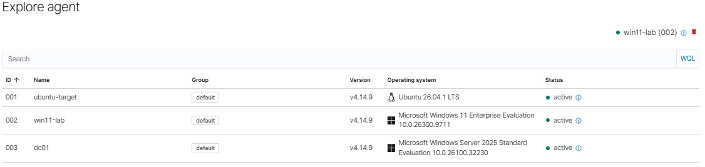
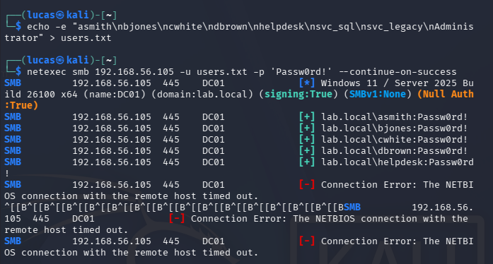
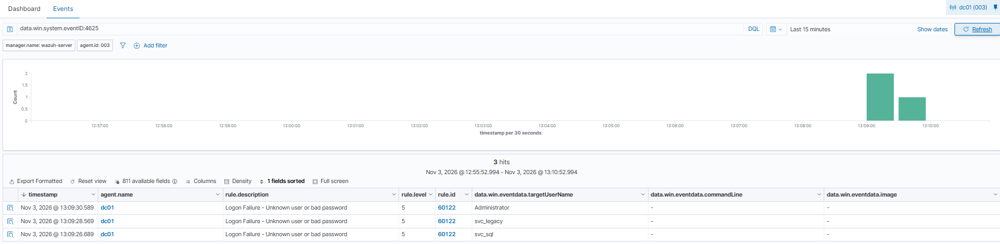
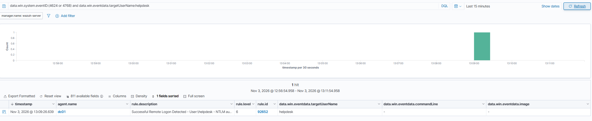
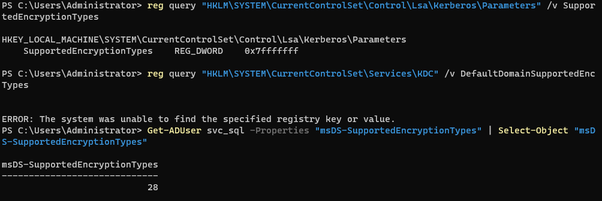
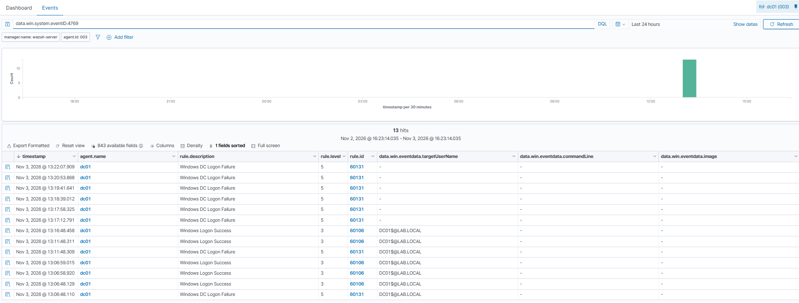
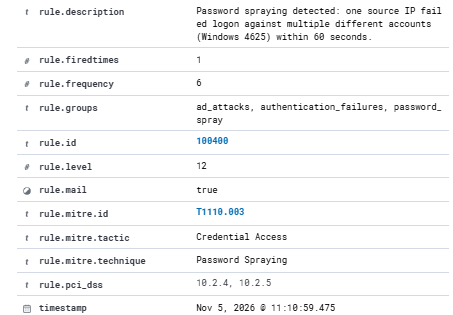

# Active Directory Attacks and Detection

This is the lab I was building toward the whole time. The last project put one Windows machine into my lab. This one adds a Windows Server 2025 domain controller, joins the Windows 11 box to the domain, and runs the attacks a SOC actually deals with in Active Directory: password spraying, Kerberoasting and AS-REP roasting. Everything reports into Wazuh, and this time I wrote and tested a custom rule to catch the spray instead of just logging it.

Some of these attacks worked exactly like the textbook. Some got stopped by Server 2025's defaults, which turned out to be a better finding than if they'd just worked. I wrote both down, including the parts that fought me.

Everything was done inside my own home lab, against my own VMs. Lab setup: [Home Lab Setup](../../home-lab/)

## Summary

- Built a domain (`lab.local`) on Windows Server 2025, joined the Windows 11 machine to it, and put a Wazuh agent on the DC
- **Password spray:** one common password against every account found 5 valid logins, including a Domain Admin. In Wazuh it barely registered, the opposite of the loud RDP brute force from my last project
- **Wrote a custom spray rule (100400):** it fires at **level 12** when one source IP fails logon against several different accounts in a short window. Tested it, it caught the spray where the built-in rules only saw scattered failures
- **Kerberoasting:** the attack ran and the DC logged it (event 4769), but **Server 2025 would not hand out a crackable RC4 ticket**. I pushed on this one hard and proved it was the KDC itself refusing, not a setting I missed
- **AS-REP roasting:** correctly found the one account with pre-auth disabled, and hit the same encryption wall
- **Tooling finding:** the impacket on my Kali only ever requests RC4, so once the DC stopped issuing RC4 no account setting could help. Pulling a crackable ticket here needs an AES-aware tool, which is the follow-up

## Lab and tools

| | |
|---|---|
| Attacker | Kali Linux, 192.168.56.102 |
| Domain controller | Windows Server 2025, DC01, 192.168.56.105, domain lab.local |
| Workstation | Windows 11, WIN11-LAB, 192.168.56.104, joined to lab.local |
| SIEM | Wazuh 4.14.9, 192.168.56.103, agent on the DC |
| Attack tools | NetExec, impacket (GetUserSPNs, GetNPUsers) |

Times are Florida time (UTC-5).

## 1. Building the domain

I installed the AD role on the server and promoted it to a domain controller for a new domain, `lab.local`:

```
Install-WindowsFeature AD-Domain-Services -IncludeManagementTools
Install-ADDSForest -DomainName "lab.local" -DomainNetbiosName "LAB" -InstallDns
```

Then I created a small company: four regular users, a helpdesk account I put in Domain Admins, and two service accounts. The service accounts are set up weak on purpose, because that's exactly how they end up in real environments.

| Account | Set up as | Why |
|---|---|---|
| asmith, bjones, cwhite, dbrown | Regular users, shared password | A normal office where everyone uses the same weak password |
| helpdesk | Domain Admin | An over-privileged account, the kind attackers hunt for |
| svc_sql | Service account with an SPN | Kerberoasting target |
| svc_legacy | Pre-authentication turned off | AS-REP roasting target |

I joined the Windows 11 machine to the domain so the lab is realistic: one server, one workstation, and a normal domain user to log in as. Then I put the Wazuh agent on the DC and turned on Kerberos auditing so service ticket requests get logged:

```
auditpol /set /subcategory:"Kerberos Service Ticket Operations" /success:enable /failure:enable
```



All three machines reporting into Wazuh: Ubuntu, Windows 11, and now the domain controller.

## 2. Password spraying

A brute force throws many passwords at one account and locks it out fast. A spray does the opposite: one common password against every account, once each. It stays under the lockout limit and counts on at least one person using a weak password.

From Kali, I sprayed `Passw0rd!` against the whole user list:

```
netexec smb 192.168.56.105 -u users.txt -p 'Passw0rd!' --continue-on-success
```



Five hits, including **helpdesk**, which is a Domain Admin. One weak password, shared across the office, was enough to log in with Domain Admin rights. Reused passwords like that are a common starting point for real intrusions.

### What the DC logged

This is the part that matters for a SOC. In Wazuh, the failures:



Only **3 failed logons** showed up (event 4625, level 5), and those were just the three accounts whose password wasn't `Passw0rd!`. The five accounts that matched logged a clean success. So from the DC's point of view, five people logged in normally and three typed their password wrong once. Nothing looks like an attack.

The one that should scare you is the success:



**helpdesk**, a Domain Admin, authenticated from Kali and it logged as a normal remote logon (level 6). No burst, no lockout, no high alert.

That's the whole lesson, and it's a sharp contrast with my last project:

| | RDP brute force (last project) | Password spray (this one) |
|---|---|---|
| Pattern | Many passwords, one account | One password, many accounts |
| In the logs | 10 failures in a second | One failure per account |
| Lockout | Yes, account locked | No, stays under the limit |
| Alert | Level 10 | Looks like normal logins |

The brute force in my last project tripped alerts right away. This spray didn't, which is what makes it effective, and what the rule in Section 5 tries to catch.

## 3. Kerberoasting

In Active Directory, any logged-in user can ask the domain controller for a service account's ticket, and that ticket is encrypted with the service account's password. So you ask as a normal user, take the ticket offline, and try to crack the password without the DC ever seeing you guess.

I requested svc_sql's ticket from Kali with impacket:

```
impacket-GetUserSPNs lab.local/asmith:'Passw0rd!' -dc-host dc01.lab.local -request -outputfile kerb.txt
```

The request itself worked, the tool found svc_sql by its SPN, and the DC logged **event 4769** for it every time. But the crack never happened, because of this:

```
KDC_ERR_ETYPE_NOSUPP (KDC has no support for encryption type)
```

**Server 2025 ships with the old RC4 encryption disabled.** The cracking tools request the ticket in RC4 because it's the easiest to crack, and the DC refuses to issue one.

I did not take that at face value. I wanted to know whether it was the account, a policy, or the DC itself, so I checked each layer:

```
reg query "HKLM\SYSTEM\CurrentControlSet\Control\Lsa\Kerberos\Parameters" /v SupportedEncryptionTypes
```

The DC's own Kerberos was already set to `0x7fffffff`, which is every encryption type including RC4. So the DC was not configured to block it. I then set svc_sql to RC4 only and reset its password, so the account had nothing but an RC4 key to hand out:

```
Set-ADUser svc_sql -KerberosEncryptionType RC4
Set-ADAccountPassword svc_sql -Reset -NewPassword (ConvertTo-SecureString "Summer2024" -AsPlainText -Force)
Restart-Service Kdc -Force
```



The check above says it all: the DC's Kerberos allows every type (`0x7fffffff`) and svc_sql's `msDS-SupportedEncryptionTypes` is `28` (RC4 plus AES). I re-ran the roast anyway, same `KDC_ERR_ETYPE_NOSUPP`. The account allowed only RC4, the DC allowed everything, and the KDC still would not mint the ticket. So this isn't a setting I missed. **On this build the KDC refuses to issue an RC4 service ticket at all**, no matter how the account or the policy is configured.

There was a tooling piece too. The impacket version on my Kali only ever asks for an RC4 ticket, so once the DC stopped issuing RC4 there was no account setting that would help, even setting the account to AES only still failed because the tool never asked for AES. To actually pull a crackable ticket here I'd need a tool that requests an AES ticket (Rubeus), then crack the AES hash offline. That's the follow-up, listed at the end.

For a lab, this is a more useful result than a crack would have been. A domain left on modern defaults, AES only, takes a whole class of attack off the table. It's also something a defender should check: if someone turns RC4 back on later for a compatibility fix, they reopen this door.

### What the DC logged

The 4769 events did reach Wazuh:



Every single one came in at **level 3**, mapped to generic rules like "Windows Logon Success." A service ticket request for a service account is the exact fingerprint of Kerberoasting, and nothing flagged it. That's a detection gap a custom rule would close, and now that RC4 is off the rule has to watch for the AES request pattern instead of the classic RC4 ticket. I've got that on the next-steps list.

## 4. AS-REP roasting

This one targets accounts that have Kerberos pre-authentication turned off, a setting that occasionally gets flipped for old software. Those accounts will hand out crackable data to anyone, no password needed at all.

```
impacket-GetNPUsers lab.local/ -usersfile users.txt -no-pass -dc-host dc01.lab.local -format john
```

It correctly picked out **svc_legacy** as the only account missing pre-auth (every other account came back as "doesn't have UF_DONT_REQUIRE_PREAUTH set"). So the attack found its target on its own. Then it hit the same encryption wall as the Kerberoast, so the crackable blob never came out.

Two attacks, same Server 2025 defense. Consistent, and worth knowing.

## 5. Writing a detection rule for the spray

Back to section 2. The spray is the attack that actually worked here, and it's the one Wazuh barely noticed. Wazuh's built-in rule for Windows failures is **60204 "Multiple Windows Logon Failures."** It fires on volume, a bunch of 4625s in a window, and it can't tell the difference between a spray and one account getting brute forced. I wanted a rule that keys on the shape of a spray specifically: **one source IP failing against several different accounts.**

This went in `/var/ossec/etc/rules/local_rules.xml` on the Wazuh server:

```xml
<group name="ad_attacks,authentication_failures,">
  <rule id="100400" level="12" frequency="6" timeframe="60">
    <if_matched_group>authentication_failed</if_matched_group>
    <same_field>win.eventdata.ipAddress</same_field>
    <different_field>win.eventdata.targetUserName</different_field>
    <description>Password spraying detected: one source IP failed logon against multiple different accounts (Windows 4625) within 60 seconds.</description>
    <mitre>
      <id>T1110.003</id>
    </mitre>
    <group>password_spray,pci_dss_10.2.4,pci_dss_10.2.5,</group>
  </rule>
</group>
```

- `if_matched_group authentication_failed` builds on the failure events Windows is already generating, so I'm not re-decoding 4625 myself
- `same_field win.eventdata.ipAddress` + `different_field win.eventdata.targetUserName` is the core of it: one source IP failing against several different accounts. That pattern is what separates a spray from one account getting a few wrong passwords
- `frequency 6` in a `60` second window, `level 12`. Higher than the built-in volume rule, because this one means something specific
- MITRE **T1110.003 Password Spraying**

### Testing it

I sprayed a password that none of the accounts use, which is the normal situation for a spray, the attacker is guessing. Eight failures from one IP across eight different accounts:

```
netexec smb 192.168.56.105 -u users.txt -p 'FakePass123!'
```



**Rule 100400 fired at level 12**, MITRE T1110.003, with the source IP and the list of targeted accounts. The built-in 60204 still fired too, so now there's a plain "lots of failures" alert and a sharper "this is a spray" alert sitting next to it.

One limitation worth stating. This rule needs the spray to fail a lot. The spray from Section 2 that actually got helpdesk used a password that was already valid, so it produced only a couple of failures and would stay under this rule's threshold. Catching that version means correlating successful logons by source IP, not failures, which is on the next-steps list.

One thing from building it: my first version used `authentication_failures` (plural) in `if_matched_group` and never fired. That plural is the group name Wazuh puts on the finished alert; the group it uses to chain the raw failure events is `authentication_failed`, singular. The built-in 60204 rule showed me the right one.

## Triage notes

### Password spray (the quiet one)

**Who:** 192.168.56.102 (Kali)

**What:** One password tried against 8 accounts. 5 succeeded, including the helpdesk Domain Admin

**When:** 2026-11-05

**Where:** DC01, 192.168.56.105

**MITRE ATT&CK:** T1110.003 Password Spraying, T1078 Valid Accounts

**When:** 2026-11-03

**Severity:** Critical. A Domain Admin account is compromised and the logon looks normal, so it won't jump out in the logs

**What I'd do:** Look for one source IP authenticating as several different users in a short window, even when the attempts succeed. My rule 100400 now catches the failing version of that automatically. Then force a password reset on helpdesk and every account that matched, check what helpdesk did after logging in, and get everyone off the shared password. Long term, this is why MFA and a ban on common passwords exist. In this case it was my own test.

### Kerberoasting / AS-REP roasting

**Who:** asmith (a normal domain user), from Kali

**What:** Requested a service ticket for svc_sql (4769), and requested AS-REP data for svc_legacy

**MITRE ATT&CK:** T1558.003 Kerberoasting, T1558.004 AS-REP Roasting

**Severity:** Medium here, because Server 2025's AES-only setting blocked the crackable part. Would be High on an older domain

**What I'd do:** Confirm the domain still blocks RC4 and that no service account has been switched back to it. Watch for one user requesting service tickets for multiple SPNs quickly. Give service accounts long random passwords, or move them to group managed service accounts so there's nothing worth cracking.

## Issues I ran into

**The Wazuh disk filled to 100% and nothing would start.** The indexer kept failing with "No space left on device." The Vulnerability Detection module had filled the 25 GB disk, its feed folders came to about 20 GB, and a single feed file in `vd_updater` was 4.3 GB on its own. What threw me for a while: deleting the feed files looked like it did nothing. `df` stayed at 100% after a clean `rm`. Two reasons. The services were still running and holding the deleted files open, so the space never came back, and the module just re-downloaded the feed on the next start. The fix was to stop every service (manager, indexer, dashboard and filebeat), clear the feed, and disable Vulnerability Detection so it stops pulling a feed too big for this disk. Lesson I'll keep: `df` said full and `du` said the files were there, both were right, I was reading them before the services let go.

**Kali tools couldn't Kerberoast Server 2025, and I proved why.** Both impacket and NetExec failed with `KDC_ERR_ETYPE_NOSUPP`. I went through it layer by layer: the DC's Kerberos already allowed every encryption type, I set the service account to RC4 only, and the KDC still refused to issue an RC4 ticket. So it's the KDC on this build, not a policy or the account. On top of that, the impacket on my Kali only ever requests RC4, so even setting the account to AES only didn't help, the tool never asked for AES. The clean takeaway is that modern AD resists the classic attack out of the box, and pulling a crackable ticket here needs an AES-aware tool, not a config change.

**My spray rule was silent over one wrong word.** First version matched `authentication_failures`, the group name on the finished alert, instead of `authentication_failed`, the group Wazuh uses to chain the raw failure events. It parsed fine and never fired. Reading the built-in rule that does work (60204) showed me the exact group to match.

**The DC clock was 3 hours behind.** New events were landing in Wazuh stamped 3 hours in the past, so they never showed up in the dashboard's "last 15 minutes." The server was still on Pacific time while the rest of the lab was on Eastern. The events were fine, the dashboard window was looking in the wrong place. `Set-TimeZone` fixed it. Good reminder that time sync is not optional in a SIEM, and that a quiet dashboard doesn't always mean nothing happened.

## Lessons learned

- **A successful spray barely shows up.** It compromised a Domain Admin and logged like a normal login, while the noisy brute force from my last project got caught right away
- **Wazuh logged these events without flagging them.** The spray and Kerberoast events sat at low levels until I wrote a rule for the pattern, and even that rule only catches the loud version of the spray
- **A spray has a shape: one source, many accounts.** The built-in rule only counts failure volume. Mine keys on that shape
- **Match the engine's exact field.** One wrong word in the group name and the rule never fired. The built-in rule that already works is the best reference for wiring a new one
- **Modern defaults did real work.** Server 2025 blocking RC4 shut down two classic attacks on its own, though one compatibility change could reopen them
- **Check the clock, and check your tools.** A time skew made Wazuh look broken, and my cracking tool only ever requesting RC4 hid that the DC's refusal was the real wall

## Limitations

- **No successful crack.** Server 2025 blocked RC4 and my Kali tooling only requests RC4, so the roasting attacks proved the defense but never produced a cracked password. Showing the full chain here means using a tool that requests AES (Rubeus) and cracking the AES hash, or deliberately weakening the domain's encryption. That's a planned follow-up, not a finished result
- **The spray rule only catches the loud spray.** A spray that uses an already-valid password, like the one that got helpdesk, only fails a couple of times and slips under rule 100400. Catching that needs correlating successful logons by source, not failures
- **Small, quiet domain, one attacker.** A real domain has thousands of logons an hour, which is exactly what makes a spray so easy to hide in

## What I'd do next

- Write a Kerberoast detection rule. With RC4 off, it has to watch for the AES service ticket pattern, one user requesting 4769 tickets for several SPN accounts in a row, rather than the classic RC4 ticket
- Pull a crackable ticket with an AES-aware tool (Rubeus) and crack it offline, to show the full Kerberoast chain end to end
- Detect the quiet spray by correlating successful logons from one source across many accounts, not just failures
- Set up a second domain-joined machine to show lateral movement, logging in to one box with creds stolen from another
- Turn on Wazuh active response so a confirmed spray can disable an account or block an IP on its own
