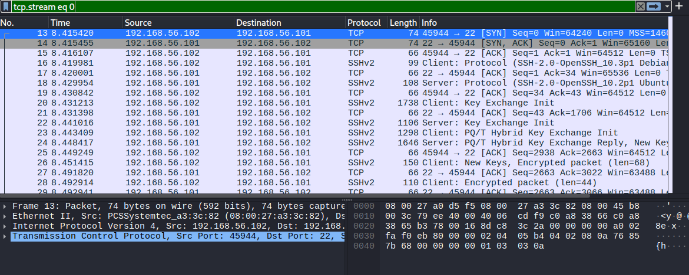
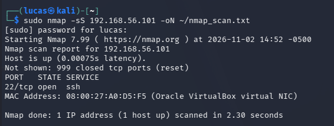
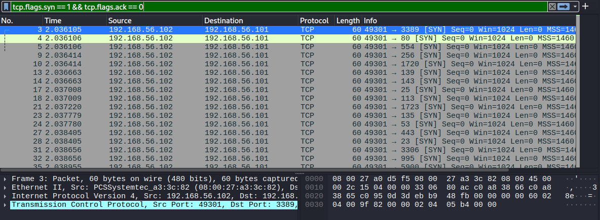
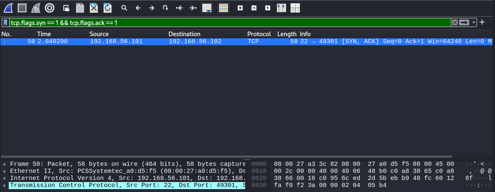
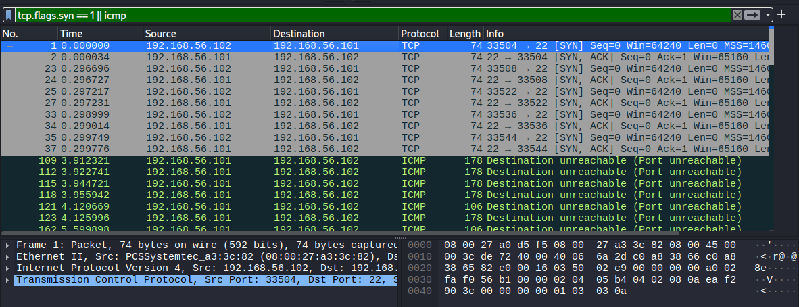

# Network Traffic Investigation: Port Scan and Brute Force on the Wire

In my [SSH project](../ssh-attack-detection/) I found a brute force attack in the logs. In this one I wanted to see attacks from the network side. I captured packets on Ubuntu with tcpdump while Kali did normal traffic, a port scan and a brute force, then analyzed the captures in Wireshark to find what gives each one away.

Everything was done inside my own home lab, against my own VMs. Lab setup: [Home Lab Setup](../../home-lab/)

## Summary

- Captured a normal baseline first so I knew what regular traffic looks like
- An nmap SYN scan sent **1,000 SYNs in 0.21 seconds** and never completed a single handshake. The packets also had a fingerprint that makes them look different from normal traffic
- The brute force only showed up as **5 TCP connections** on the wire, because the password guesses happen inside encrypted SSH sessions. The logs from my last project showed a lot more
- I caught the fail2ban ban in the packets: Ubuntu started answering Kali with **ICMP port unreachable 0.27 seconds after the ban**, and kept rejecting it 42 times over the next 2 minutes

## Lab and tools

| | |
|---|---|
| Attacker | Kali Linux, 192.168.56.102 |
| Target | Ubuntu 26.04.1 LTS, 192.168.56.101 (SSH open, fail2ban running) |
| Capture | tcpdump on Ubuntu's host-only adapter (enp0s8) |
| Analysis | Wireshark on Kali, tcpdump filters |
| Attack tools | nmap, Hydra |

Every capture used this filter so it only picked up Kali's traffic:

```
sudo tcpdump -i enp0s8 -nn -w <file>.pcap host 192.168.56.102
```

I was connected to Ubuntu over SSH from my Windows host while capturing. Without `host 192.168.56.102` the capture would have been full of my own session.

All times are UTC.

## Captures

| File | What's in it | Packets |
|---|---|---|
| [01_baseline.pcap](captures/01_baseline.pcap) | Ping and one normal SSH login | 907 |
| [02_portscan.pcap](captures/02_portscan.pcap) | nmap SYN scan of the top 1,000 ports | 2,005 |
| [03_bruteforce.pcap](captures/03_bruteforce.pcap) | Hydra SSH brute force with fail2ban on | 284 |

Anyone can download these and open them in Wireshark.

## 1. Baseline: what normal looks like

From Kali I pinged Ubuntu 4 times and logged in over SSH once with the right password.



Filter: `tcp.stream eq 0`

- **Ping:** 4 ICMP echo requests, 4 echo replies
- **TCP 3-way handshake:** `SYN` from Kali, `SYN, ACK` from Ubuntu, `ACK` from Kali. Every normal TCP connection starts this way
- **SSH version banners:** these go out in plain text before encryption starts. Kali is `OpenSSH_10.3p1 Debian` and Ubuntu is `OpenSSH_10.2p1 Ubuntu-2ubuntu3.8`. Anyone watching or scanning the network can see what software and OS the server runs
- **After the key exchange** everything is encrypted. You can't see the password or the commands I ran

907 packets for one short session is normal. SSH sends a packet for pretty much every keystroke.

A normal Linux SYN from Kali looks like this: window size **64240** with options `mss, sackOK, timestamp, nop, wscale`. That matters for the next part.

## 2. Port scan

```
sudo nmap -sS 192.168.56.101
```

`-sS` is a SYN scan, also called a half-open scan. It sends a SYN to each port and never finishes the handshake.



nmap found **1 open port (22/ssh)** and 999 closed in 2.3 seconds. It also picked up that the MAC address belongs to a VirtualBox virtual NIC, so the attacker even learns the target is a VM.

### What it looks like in the packets



Filter: `tcp.flags.syn == 1 && tcp.flags.ack == 0`

| What | Count | Meaning |
|---|---|---|
| SYN from Kali | 1,000 | One to each port |
| SYN-ACK from Ubuntu | 1 | Only port 22 answered as open |
| RST | 1,000 | 999 from Ubuntu for closed ports, 1 from Kali |
| Time for all 1,000 SYNs | 0.21 seconds | |

Only one port answered:



Filter: `tcp.flags.syn == 1 && tcp.flags.ack == 1`

When port 22 answered with a SYN-ACK, Kali sent a **RST** back instead of an ACK. It found out the port was open and hung up without ever connecting. That's the "half-open" part, and it's why a SYN scan never shows up in the SSH logs.

### What gives it away

- **Volume and speed.** 1,000 different ports from one IP in 0.21 seconds. No normal user or app does that
- **No completed handshakes.** Normal traffic is SYN, SYN-ACK, ACK. The scan is SYN, then RST or nothing
- **Ports in random order** (3389, 80, 554, 256...). nmap shuffles them on purpose
- **The packets don't look like normal Linux packets.** I compared them to the baseline:

| | Normal SYN from Kali | nmap scan SYN |
|---|---|---|
| Window size | 64240 | **1024** on all 1,000 |
| TCP options | mss, sackOK, timestamp, nop, wscale | **mss only** |
| Source port | New one for each connection | **49301** on all 1,000 |

nmap builds these packets itself instead of using the normal OS network stack, so they end up with a fingerprint. A window size of 1024 with only the MSS option, all from one source port, is something an IDS or a SOC analyst can look for.

**fail2ban didn't react to the scan at all.** It only watches for failed logins and a SYN scan never logs in. So the scan was completely invisible in the logs I used in my last project.

## 3. Brute force on the wire

```
hydra -l labuser1 -P ~/lab_passwords.txt -t 4 -V ssh://192.168.56.101
```

Same attack as my SSH project, 20 passwords, 4 at a time, with fail2ban on.



Filter: `tcp.flags.syn == 1 || icmp`

### Timeline

| Time | What happened |
|---|---|
| 19:56:03.599 | Hydra opens a test connection |
| 19:56:03.896 | 4 more connections open within 3 milliseconds of each other |
| 19:56:07.237 | fail2ban bans Kali (from fail2ban's log) |
| 19:56:07.511 | Ubuntu starts answering with `ICMP port 22 unreachable` |
| 19:58:01.795 | Last ICMP rejection. 42 total over about 2 minutes |

### What I found

**Only 5 connections.** On the network the whole attack is 5 SYNs and 5 SYN-ACKs. Hydra opened its connections and then tried multiple passwords inside each one. Since SSH is encrypted after the key exchange, the password guesses and the failures are invisible on the wire. In my SSH project the logs showed every single failed password. Here all you can see is the pattern: one IP opening 4 SSH connections at the same time and sending steady traffic.

**How the ban actually works.** fail2ban's firewall rule doesn't just drop Kali's packets, it sends back `ICMP port unreachable`. That's why Kali got "Connection refused" instead of hanging. It also killed the connections that were already open. There are **0 RSTs** in the capture, so none of the sessions closed normally. They just got cut off mid-attack, and Hydra kept retrying into the block for 2 more minutes.

## Triage notes

### Port scan

**Who:** 192.168.56.102 (Kali)

**What:** TCP SYN scan of the top 1,000 ports, 1 open port found (22/ssh)

**When:** 2026-11-02, 19:52:11.556 to 19:52:11.769 UTC

**Where:** Ubuntu, 192.168.56.101

**MITRE ATT&CK:** T1046 Network Service Discovery

**Severity:** Low on its own, it's reconnaissance and nothing got in. But a scan is usually the first step. In a real environment I'd watch that IP for what comes next, which in this lab was the brute force.

### Brute force

**Who:** 192.168.56.102 (Kali)

**What:** SSH brute force, 5 parallel connections, blocked by fail2ban

**When:** 2026-11-02, 19:56:03 to 19:58:01 UTC

**MITRE ATT&CK:** T1110.001 Brute Force: Password Guessing

**Severity:** Medium. Blocked and no login succeeded. See my [SSH project](../ssh-attack-detection/) for the log side.

## Lessons learned

- **Logs and network data show different things.** The logs showed every failed password but nothing about the port scan. The packets showed the scan clearly but only 5 connections for the brute force. You need both to see the whole thing
- **Encryption hides the content, not the pattern.** I couldn't read anything inside SSH, but the timing, number of connections and source IP were enough to see something was wrong
- **Look at what's normal first.** The nmap fingerprint (window 1024, one source port) only stood out because I had a baseline to compare it to
- **Tools have gaps.** fail2ban stopped the brute force but completely missed the scan

## Limitations

- One attacker, one target, on a quiet private network. On a real network this traffic would be mixed in with a lot of other stuff
- Default nmap settings. A slower scan, a different scan type or one spread across many IPs would be a lot harder to spot
- No IDS running. I found these patterns by hand with filters. Next step is a tool that alerts on them automatically

## What I'd do next

- Add a SIEM or IDS to the lab so scans and brute forces trigger alerts on their own. I added Wazuh in my [next project](../wazuh-siem-detection/)
- Try slower and stealthier nmap scans and see what still gets caught
- Turn on ufw to limit who can reach SSH in the first place

## Next project

I added a SIEM to the lab and ran these attacks again in [SIEM Detection with Wazuh](../wazuh-siem-detection/).
