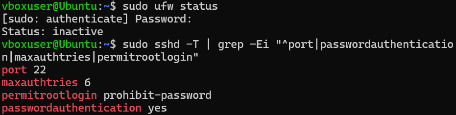
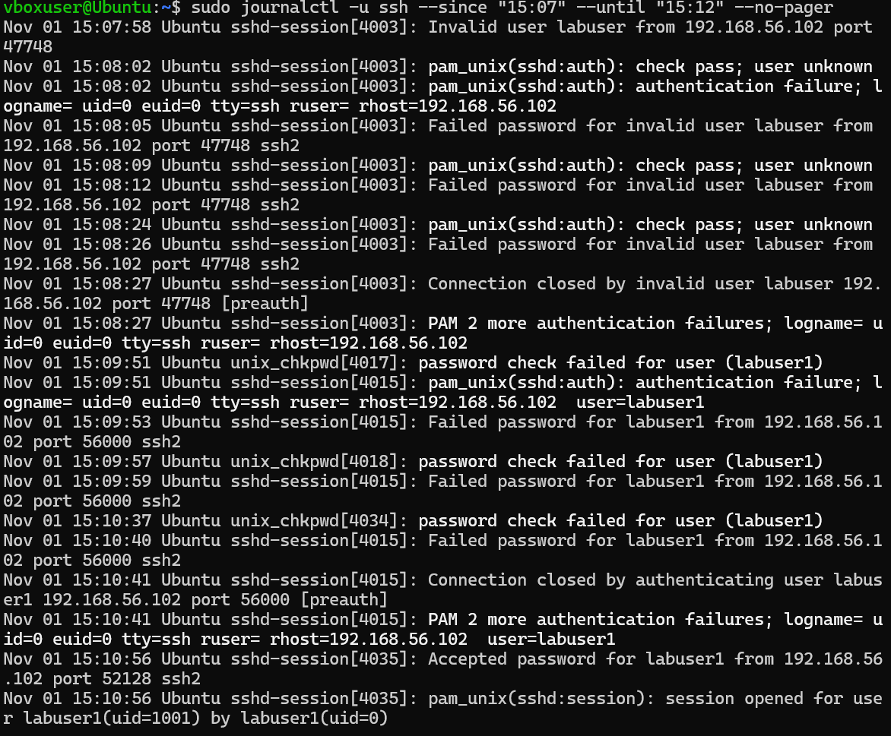
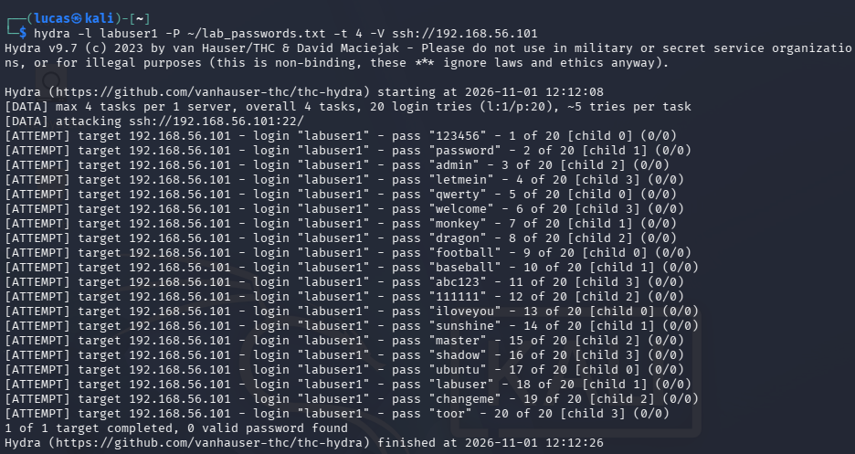
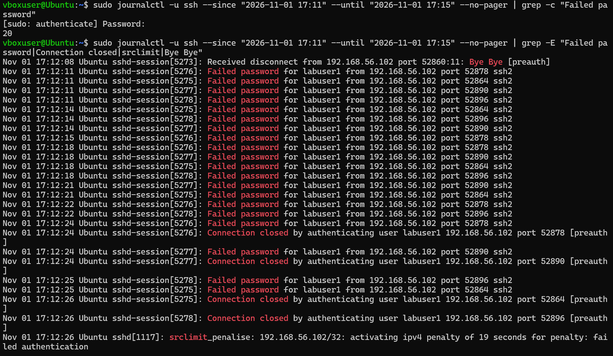
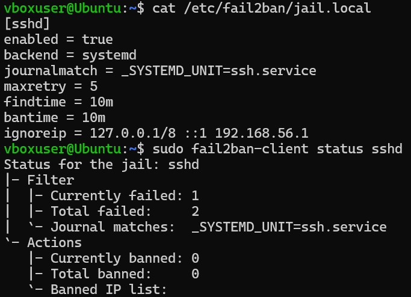
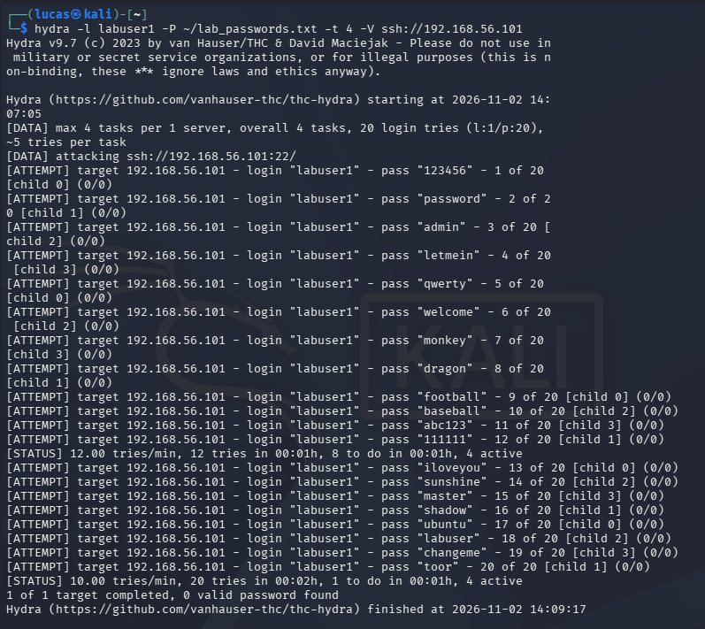
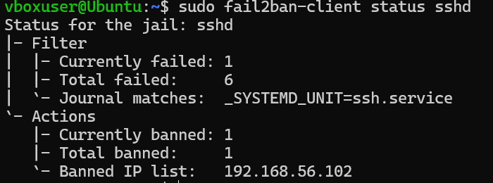
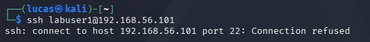
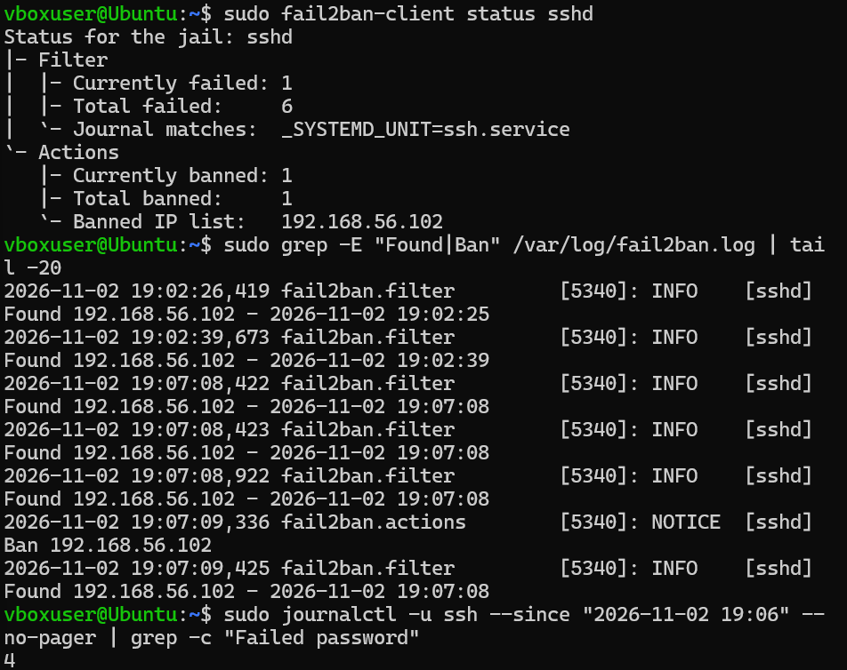

# Linux SSH Attack Detection and Defensive Validation

In this project I ran a controlled SSH brute force attack from Kali against my Ubuntu VM, found it in the logs the way a Tier 1 SOC analyst would, added a defense (fail2ban), and then ran the same attack again to prove the defense actually worked.

Everything was done inside my own home lab, against my own VMs. Setup for the lab is here: [Home Lab Setup](../../home-lab/)

## Summary

- Ran Hydra from Kali against a test account on Ubuntu, 20 password guesses in about 18 seconds
- All 20 failed attempts showed up in Ubuntu's SSH logs, so detection matched what the attacker actually did
- Installed and configured fail2ban to ban an IP after 5 failed logins in 10 minutes
- Ran the same attack again. Kali got banned about 4 seconds in and only 4 failed attempts reached SSH instead of 20
- After the ban, Kali got "Connection refused" while my admin access from the Windows host kept working

## Lab and tools

| | |
|---|---|
| Attacker | Kali Linux, 192.168.56.102 |
| Target | Ubuntu 26.04.1 LTS, 192.168.56.101 |
| Admin access | Windows host over SSH, 192.168.56.1 |
| Tools | Hydra, journalctl, fail2ban, OpenSSH |
| Test account | labuser1 (regular user, no sudo) |

I made a separate test account so all the activity in the logs is tied to one user and so I didn't risk locking out my real admin account.

Note: Ubuntu logs in UTC and Kali shows Florida time (UTC-5). All times below are UTC. The baseline and first attack were on 2026-11-01, the fail2ban setup and re-test were the next day, 2026-11-02.

## 1. Baseline

Before doing anything I checked the firewall and SSH settings so I had a "before" picture.



| Setting | Value | What it means |
|---|---|---|
| ufw firewall | inactive | Nothing filtering traffic to SSH |
| Port | 22 | Default SSH port |
| MaxAuthTries | 6 | 6 password guesses per connection before it drops you |
| PermitRootLogin | prohibit-password | Root can't log in with a password |
| PasswordAuthentication | yes | Password logins allowed, this is what makes brute force possible |

Then I did a few manual logins from Kali to make sure logging worked. This ended up being a good example on its own:

- 15:07:58 - 3 failed attempts against `labuser`, a username that doesn't exist (I typo'd it)
- 15:09:53 - 3 failed attempts against `labuser1`, a real account
- 15:10:56 - successful login as `labuser1`



The logs show the difference between a fake username (`Invalid user` / `Failed password for invalid user`) and a real one with a wrong password (`Failed password for labuser1`). Full log: [baseline_ssh_log.txt](logs/baseline_ssh_log.txt)

If I saw this in a real SOC, failures followed by a success from the same IP is the kind of thing I'd escalate to check if the login was authorized. In this case it was me.

## 2. The attack

I made a small wordlist of 20 common passwords and left the real password out on purpose, so the attack would fail every time and the real password never shows up anywhere.

```
hydra -l labuser1 -P ~/lab_passwords.txt -t 4 -V ssh://192.168.56.101
```

- `-l labuser1` one username to attack
- `-P` the password list
- `-t 4` 4 attempts at a time
- `-V` show every attempt



All 20 attempts ran in about 18 seconds. 0 valid passwords found.

## 3. Detection and analysis

I pulled the SSH logs for the attack window and counted the failures:

```
sudo journalctl -u ssh --since "2026-11-01 17:11" --until "2026-11-01 17:15" --no-pager | grep -c "Failed password"
```

Result was **20**, which matches exactly what Hydra sent.



Full log: [hydra_attack_log.txt](logs/hydra_attack_log.txt)

What the logs show:

- **17:12:08** Hydra makes a test connection first and disconnects ("Bye Bye"). It does this to check that password logins are allowed
- **4 sessions at the same time** (5275 to 5278), each from a different source port. A person typing doesn't fail 4 logins in the same second, so this points to an automated tool
- **5 failures per session, 20 total**, about 3 seconds apart because of Linux's built-in delay after a wrong password
- **17:12:26** OpenSSH put a 19 second penalty on Kali's IP on its own (`srclimit_penalise`). This is a newer built-in OpenSSH feature, I didn't turn it on. It helps but 19 seconds won't stop someone who just waits it out

### Triage notes

**Who:** 192.168.56.102 (Kali, internal lab machine)

**What:** SSH password brute force against labuser1, 20 failed attempts, no successful login

**When:** 2026-11-01, 17:12:08 to 17:12:26 UTC

**Where:** Ubuntu target, SSH on port 22

**Why:** Password authentication is enabled and nothing was blocking repeated failures

**Classification:** True positive, password guessing. In this case it's an authorized test.

**MITRE ATT&CK:** T1110.001 Brute Force: Password Guessing (one known username, list of common passwords)

**Severity:** In a real environment I'd call this medium. No login succeeded, but the attack was fast and nothing stopped it. If there had been a successful login after the failures, it goes up to high and gets escalated right away.

**Recommended action:** Block the source IP, confirm no successful logins from it, and put something in place to stop repeated failures automatically.

## 4. The defense: fail2ban

fail2ban watches the logs and bans an IP with a firewall rule after too many failures.

```
sudo apt install fail2ban -y
```

Config in `/etc/fail2ban/jail.local`:

```
[sshd]
enabled = true
backend = systemd
journalmatch = _SYSTEMD_UNIT=ssh.service
maxretry = 5
findtime = 10m
bantime = 10m
ignoreip = 127.0.0.1/8 ::1 192.168.56.1
```

- Ban after **5 failures** within **10 minutes**, ban lasts **10 minutes**
- `ignoreip` keeps my Windows host from ever getting banned, so I can't lock myself out



### Issue I ran into

At first fail2ban was only reading log lines from a process called `sshd`. But on this version of Ubuntu the failed logins come from `sshd-session`, a separate process newer OpenSSH uses. So fail2ban wasn't going to see any of the failures and would never ban anything. I fixed it by adding the `journalmatch` line so it reads everything from the SSH service.

I tested it before running the attack by failing 2 logins from Kali and checking that fail2ban counted them (`Total failed: 2`). Glad I checked, otherwise the re-test would've just looked like fail2ban didn't work.

## 5. Validation: same attack again

Ran the exact same Hydra command on 2026-11-02.



fail2ban's log shows the ban:

```
19:02:26  Found 192.168.56.102   (my 2 test failures)
19:02:39  Found 192.168.56.102
19:07:08  Found 192.168.56.102   (Hydra starts)
19:07:08  Found 192.168.56.102
19:07:08  Found 192.168.56.102
19:07:09  Ban 192.168.56.102
```

The 2 test failures from earlier were still counted, so Kali hit 5 and got banned about 4 seconds into the attack. Full log: [fail2ban_ban_log.txt](logs/fail2ban_ban_log.txt)



After the ban, Kali couldn't even reach SSH:



And from my Windows host (ignored IP) I still had access the whole time:



### Before vs after

| | Before fail2ban | After fail2ban |
|---|---|---|
| Failed passwords that reached SSH | 20 | 4 |
| Time Hydra took | about 18 seconds | about 2 minutes 12 seconds |
| Hydra speed | about 66 tries/min | 10 tries/min |
| Kali blocked | No (only OpenSSH's 19 second penalty) | Yes, banned at 19:07:09 |
| New connections from Kali | Allowed | Connection refused |

One thing I noticed: Hydra's screen says it finished all 20 of 20 tries, but Ubuntu only logged 4. After the ban, Kali's connections were getting rejected and Hydra still counted them as tries. So the attacker's tool and the actual logs don't agree, and the logs on the target are what matter.

## Limitations

- This was one attacker IP. fail2ban works per IP, so a distributed attack from a lot of different IPs could stay under the limit on each one
- Bans only last 10 minutes. Someone patient could wait it out and keep going slowly
- Password authentication is still turned on. fail2ban slows guessing down but doesn't stop it completely
- Everything is in a lab on a private network, real traffic would be a lot noisier

## What I'd do next

- Switch SSH to key-based login only (`PasswordAuthentication no`). That takes password guessing off the table
- Turn on the ufw firewall and only allow SSH from trusted IPs
- Use longer bans for repeat offenders (fail2ban's `bantime.increment`)
- Send these logs to a SIEM so alerts fire automatically instead of me pulling them by hand. I did this in my [Wazuh project](../wazuh-siem-detection/)

## Next project

I looked at the same attack from the network side in [Network Traffic Investigation](../network-traffic-investigation/).

## Evidence

**Screenshots:** [screenshots/](screenshots/)

**Logs:**
- [baseline_ssh_log.txt](logs/baseline_ssh_log.txt) - manual failed and successful logins
- [hydra_attack_log.txt](logs/hydra_attack_log.txt) - full SSH log from the first Hydra attack
- [fail2ban_ban_log.txt](logs/fail2ban_ban_log.txt) - fail2ban detecting and banning Kali
