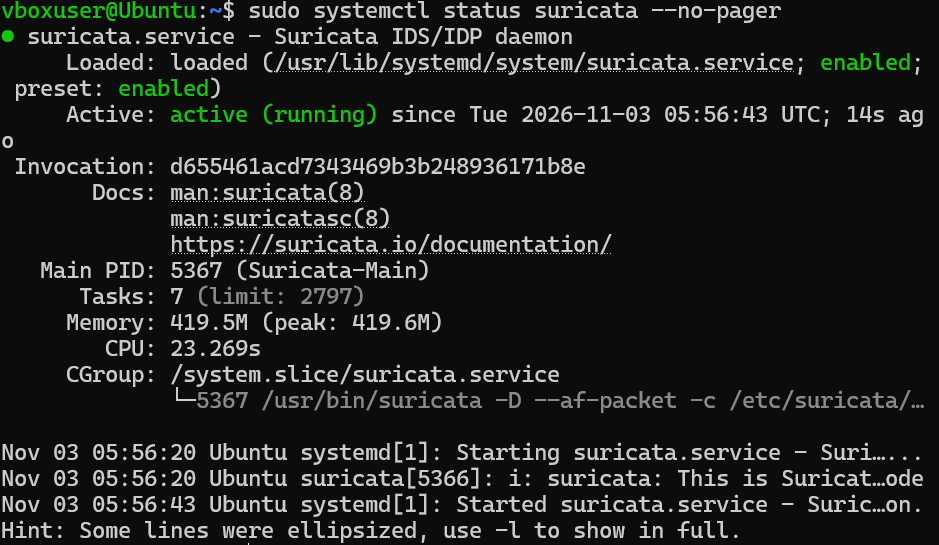
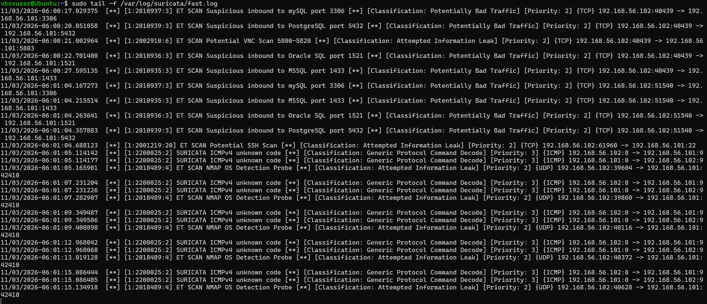
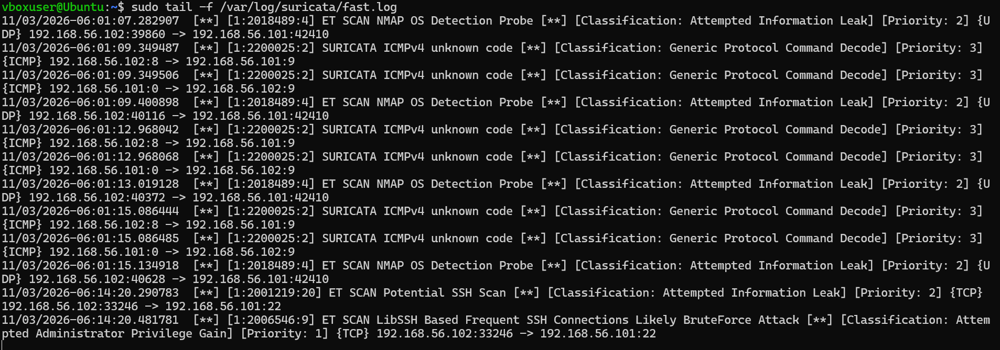
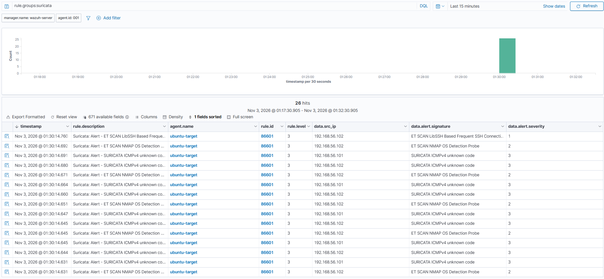
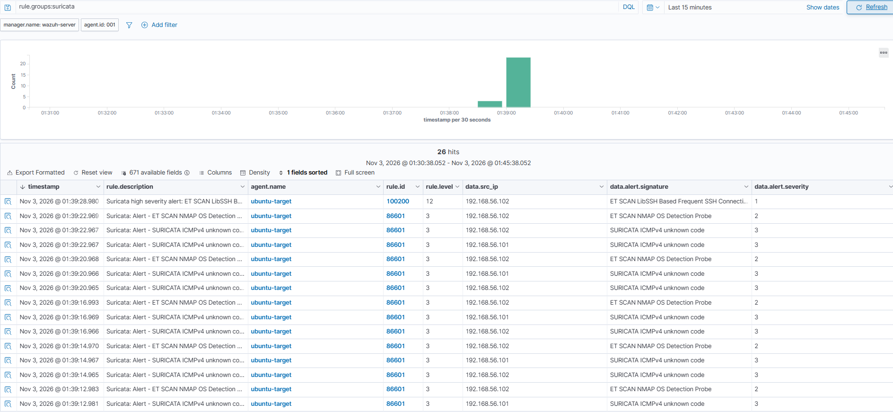

# Network IDS with Suricata: Catching What the SIEM Missed

In my [Wazuh project](../wazuh-siem-detection/) a port scan didn't show up at all. A SYN scan never finishes a connection, so Ubuntu never logs anything and Wazuh has nothing to alert on. To close that gap I added Suricata, a network IDS that watches the traffic itself instead of the logs, and connected it to Wazuh.

Then I ran the same attacks again: two nmap scans and the Hydra brute force.

Everything was done inside my own home lab, against my own VMs. Lab setup: [Home Lab Setup](../../home-lab/)

## Summary

- **Suricata caught the port scan that Wazuh missed**, but not the way I expected. A full scan of all 65,535 ports only fired 5 alerts, and none of them say "port scan"
- Suricata flagged the Hydra brute force as **Priority 1** (its highest) **5.7 seconds before fail2ban banned Kali**
- Connected Suricata to Wazuh, so network alerts now show up in the SIEM next to the log alerts
- **Found another gap:** Wazuh puts every Suricata alert at **level 3**, so the Priority 1 brute force looked exactly like ICMP noise
- **Wrote a custom Wazuh rule (100200)** that raises Suricata's highest severity alerts to **level 12**. Tested it and it fired on the brute force while the scan noise stayed at level 3

## Lab and tools

| | |
|---|---|
| Attacker | Kali Linux, 192.168.56.102 |
| Target | Ubuntu 26.04.1 LTS, 192.168.56.101, Suricata 8.0.3, Wazuh agent, fail2ban |
| SIEM | Wazuh 4.14.9, 192.168.56.103 |
| Rules | ET Open, 53,348 rules loaded |
| Attack tools | nmap, Hydra |

Suricata runs on Ubuntu and listens on enp0s8, the lab network adapter. Since it's on the target itself it only sees traffic going to and from Ubuntu, which is all I needed here.

Suricata's logs are in UTC. The Wazuh dashboard shows Florida time (UTC-5).

## 1. Setting it up

```
sudo apt install suricata -y
sudo suricata-update
```

`suricata-update` downloads the free ET Open ruleset. Two settings in `/etc/suricata/suricata.yaml` had to change:

- **The interface.** The default is `eth0`, which doesn't exist on Ubuntu. Suricata kept failing to start with `eth0: failed to find interface: No such device` until I changed it to `enp0s8`
- **HOME_NET**, which tells Suricata what it's protecting. More on this below, I got it wrong the first time



### HOME_NET

At first I set HOME_NET to the whole lab network, `192.168.56.0/24`. The problem is Suricata treats anything outside HOME_NET as the outside world, and most of the scan rules only fire on traffic coming in from outside. With the whole subnet in there, Kali counted as "inside" and those rules would never look at it.

I changed it to just the machine I'm protecting:

```
HOME_NET: "[192.168.56.101/32]"
```

Now Kali is an outsider, the same as a real attacker would be.

## 2. Port scans

### Full SYN scan

```
sudo nmap -sS -p- 192.168.56.101
```



The top 5 alerts are from this scan (06:00:17 to 06:00:27 UTC):

| Signature | Port |
|---|---|
| ET SCAN Suspicious inbound to mySQL port 3306 | 3306 |
| ET SCAN Suspicious inbound to PostgreSQL port 5432 | 5432 |
| ET SCAN Potential VNC Scan 5800-5820 | 5803 |
| ET SCAN Suspicious inbound to Oracle SQL port 1521 | 1521 |
| ET SCAN Suspicious inbound to MSSQL port 1433 | 1433 |

65,535 ports scanned and only 5 alerts. None of them is a "port scan" alert. These rules are about someone poking at database and VNC ports, which you shouldn't see from outside. Suricata noticed the scan because it happened to touch those ports, not because it recognized a scan. A scan that skipped those ports could go by without a single alert.

### Aggressive scan

```
sudo nmap -A 192.168.56.101
```

`-A` adds OS detection, version detection and nmap's default scripts, so it's a lot louder:

- **ET SCAN Potential SSH Scan** on port 22
- **ET SCAN NMAP OS Detection Probe** 5 times. This one names the tool outright
- **SURICATA ICMPv4 unknown code** in pairs

The ICMP pairs are worth a look. nmap sends ICMP packets with a strange code to fingerprint the OS. Each pair is one alert for Kali's packet and one for **Ubuntu's reply**. The reply isn't a second attack, just the target answering. Easy to count those as twice the activity if you aren't reading the source IP.

Full log: [nmap_scan_fast_log.txt](logs/nmap_scan_fast_log.txt)

## 3. Brute force

Same Hydra attack as my other projects, with fail2ban on:

```
hydra -l labuser1 -P ~/lab_passwords.txt -t 4 -V ssh://192.168.56.101
```



| Time (UTC) | Source | What happened |
|---|---|---|
| 06:14:20.290 | Suricata | ET SCAN Potential SSH Scan, Priority 2 |
| 06:14:20.481 | Suricata | **ET SCAN LibSSH Based Frequent SSH Connections Likely BruteForce Attack, Priority 1** |
| 06:14:26.231 | fail2ban | Bans Kali |

- **Suricata alerted 5.7 seconds before the ban.** It reacts to the pattern of connections right away. fail2ban has to wait for failed passwords to show up in the logs and count to 5
- The classification went from **Attempted Information Leak** (recon) to **Attempted Administrator Privilege Gain** (trying to get in). The IDS tells the story of the attack moving from scanning to attacking on its own
- SSH is encrypted, so Suricata never sees the passwords. It flagged this from the connections alone: same source, lots of SSH sessions, very fast
- fail2ban logged more failures for 2 seconds after the ban. Those were attempts Hydra's 4 threads already had going when the ban hit

Suricata detects and fail2ban blocks. They cover different moments of the same attack.

Full logs: [hydra_bruteforce_fast_log.txt](logs/hydra_bruteforce_fast_log.txt), [fail2ban_comparison_log.txt](logs/fail2ban_comparison_log.txt)

## 4. Sending Suricata alerts to Wazuh

Suricata writes everything to `/var/log/suricata/eve.json`. To get it into Wazuh I told the agent on Ubuntu to read that file, by adding this to `/var/ossec/etc/ossec.conf`:

```xml
<ossec_config>
  <localfile>
    <log_format>json</log_format>
    <location>/var/log/suricata/eve.json</location>
  </localfile>
</ossec_config>
```

Wazuh already has decoders and rules for Suricata's format, so nothing else was needed on the server. In the dashboard I searched `rule.groups:suricata` and added `data.src_ip`, `data.alert.signature` and `data.alert.severity` as columns. Suricata names its fields differently than SSH logs, so the `data.srcip` column from my last project came up empty.

## 5. The gap: everything is level 3



Every Suricata alert lands on the same Wazuh rule, **86601, level 3**. Look at the top row: Suricata rated the brute force **severity 1**, its most serious, and Wazuh still put it at level 3. Same as the ICMP noise below it.

In a real SOC, analysts sort by level. The one alert that actually matters would be buried in the pile with everything else.

## 6. The fix: custom rule 100200

Added to `/var/ossec/etc/rules/local_rules.xml` on the Wazuh server, under my rule from the last project. Full file: [rules/local_rules_suricata.xml](rules/local_rules_suricata.xml)

```xml
<group name="suricata,">
  <rule id="100200" level="12">
    <if_sid>86601</if_sid>
    <field name="alert.severity">^1$</field>
    <description>Suricata high severity alert: $(alert.signature)</description>
  </rule>
</group>
```

- `if_sid 86601` - starts from Wazuh's built-in Suricata alert rule
- `field alert.severity ^1$` - only when Suricata itself rated it severity 1. The `^` and `$` make it match exactly 1, not 10 or 11
- `level="12"` - same level as my rule 100100, both mean "look at this now"
- `$(alert.signature)` - puts Suricata's signature name right in the alert description, so you can tell what it is without opening it

### Testing it

I restarted `wazuh-manager` and ran all three attacks again.



- **The brute force came in as rule 100200 at level 12:** "Suricata high severity alert: ET SCAN LibSSH Based Frequent SSH Connections..."
- **The scan alerts stayed at rule 86601, level 3.** Severity 2 and 3 alerts didn't trigger it

## Triage notes

### SSH brute force (rule 100200)

**Who:** 192.168.56.102 (Kali)

**What:** Rapid SSH connections to labuser1, flagged by Suricata as a likely brute force. fail2ban banned the source 5.7 seconds later

**When:** 2026-11-03, 06:14:20 UTC

**Where:** ubuntu-target, 192.168.56.101, port 22

**MITRE ATT&CK:** T1110 Brute Force

**Severity:** High until confirmed blocked. Check fail2ban banned the IP and that there was no successful login from it afterward (my rule 100100 from the last project would catch that)

**What I'd do:** Confirm the ban, check for any successful login from that IP, and look for earlier scanning from the same source. In this case the same IP scanned the host minutes before, so this was recon followed by an attack. Block the IP at the firewall if it's external. In this case it was my own test.

### Port scan (rule 86601)

**Who:** 192.168.56.102 (Kali)

**What:** Full TCP SYN scan and an aggressive nmap scan with OS detection

**When:** 2026-11-03, 06:00 to 06:01 UTC

**MITRE ATT&CK:** T1046 Network Service Discovery

**Severity:** Low on its own, but it's recon. Worth watching that IP for what comes next, which here was the brute force

## Issues I ran into

**Suricata wouldn't start.** It loaded all the rules and then died with `eth0: No such device`. The command I used to change the interface in the config hadn't actually changed anything. I found it in `/var/log/suricata/suricata.log`, since `systemctl status` and `journalctl` only showed that it failed, not why. Fixed it by editing that line directly and checking it afterward.

**Wazuh API down after a reboot.** I restarted all the VMs and the dashboard said "No API available to connect". The Wazuh manager had timed out while starting, so only part of it was running. `wazuh-remoted`, the part that receives logs from agents, wasn't one of them. A clean stop and start of `wazuh-manager` fixed it. Lesson: shut the VMs down properly instead of just closing them.

**Old alerts with new timestamps.** When the manager came back, 26 alerts showed up all at the same second. These were from my earlier attacks, sent late once the manager was up. Wazuh's timestamp is when it received the event, not when the attack happened. Suricata's own time is in `data.timestamp`.

## Lessons learned

- **Logs and network traffic see different things.** Wazuh with logs missed the port scan, Suricata on the network caught it. You need both
- **IDS rules aren't magic either.** The full scan only got caught because it touched database ports. Know what your rules actually look for
- **Configure what "home" is.** One wrong setting (HOME_NET) and the scan rules would've ignored the attacker completely
- **Connecting tools isn't the same as getting value out of them.** Suricata's severity was there the whole time, Wazuh just ignored it until I wrote a rule
- **Read the source IP.** Half the ICMP alerts were the target replying, not the attacker

## Limitations

- Suricata runs on the target, so it only sees Ubuntu's traffic. A real network would have a sensor on a span port or tap seeing the whole segment
- ET Open is the free ruleset. The paid ET Pro has more and newer rules
- Rule 100200 only raises severity 1. Some severity 2 alerts, like the nmap OS detection probe, could deserve more than level 3 too
- One attacker, one target, a quiet lab

## What I'd do next

- Tune the ICMP alerts so the target's own replies don't create noise
- Write a Suricata rule of my own for something ET Open doesn't catch
- Set up Wazuh active response so a level 12 alert can block an IP automatically
- Add a Windows machine and Active Directory to the lab. I added Windows in my [next project](../windows-sysmon-detection/)

## Next project

I added a Windows 11 machine with Sysmon and attacked it in [Windows Endpoint Detection with Sysmon and Wazuh](../windows-sysmon-detection/).
