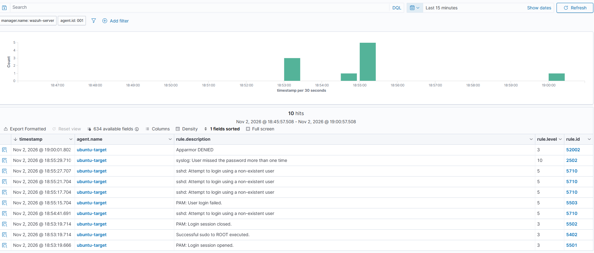
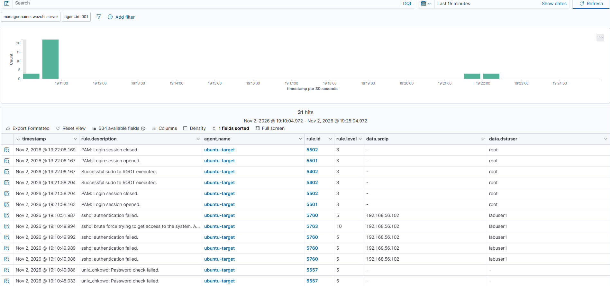
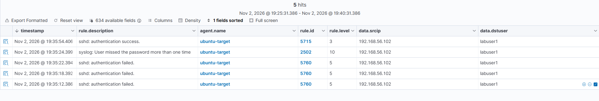
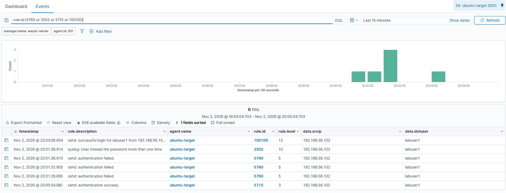
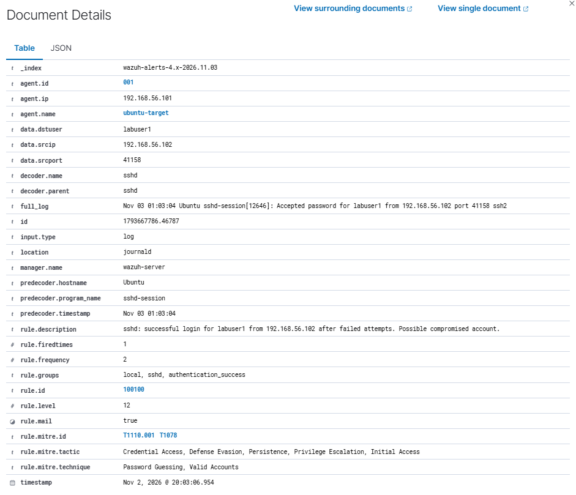
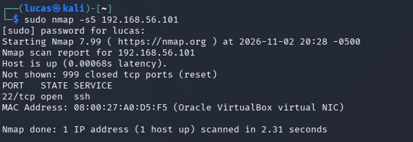
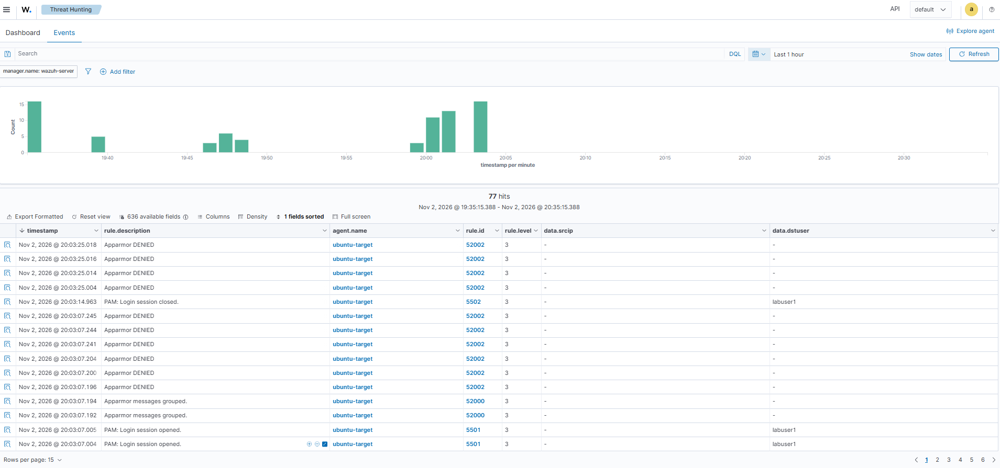

# SIEM Detection with Wazuh: Finding and Fixing a Detection Gap

In my [SSH project](../ssh-attack-detection/) and [network project](../network-traffic-investigation/) I found attacks by hand, reading logs with journalctl and packets with Wireshark. In a real SOC nobody's doing that all day, a SIEM raises alerts and the analyst triages them. So I added Wazuh to my lab, connected Ubuntu to it, and ran my attacks again to see what it would catch on its own.

The biggest finding: **Wazuh didn't flag a successful login right after failed attempts**, which is what a compromised account looks like. So I wrote a custom rule to catch it and tested it.

Everything was done inside my own home lab, against my own VMs. Lab setup, including the Wazuh install: [Home Lab Setup](../../home-lab/)

## Summary

- Wazuh caught the Hydra brute force and fired its **level 10 brute force alert** half a second after fail2ban banned Kali
- fail2ban is set to ban at 5 failures but **9 got through**, because Hydra attacks with 4 connections at the same time
- **Found a detection gap:** 3 failed logins and then a successful one from the same IP only showed up as a **level 3** alert, same as any normal login
- **Wrote a custom Wazuh rule (100100)** that raises a **level 12** alert for a successful login after failed attempts from the same IP, mapped to MITRE T1110.001 and T1078. Tested it and it fired, and it didn't fire on a normal login
- A port scan didn't show up in Wazuh at all, because a SYN scan never creates a log

## Lab and tools

| | |
|---|---|
| Attacker | Kali Linux, 192.168.56.102 |
| Target | Ubuntu 26.04.1 LTS, 192.168.56.101, Wazuh agent installed, fail2ban running |
| SIEM | Wazuh 4.14.9 (all-in-one OVA), 192.168.56.103 |
| Attack tools | Hydra, nmap, ssh |

The Wazuh agent on Ubuntu reads the system journal (`journald`), which is where Ubuntu 26.04 writes the SSH events. Before testing I checked the agent config to make sure. In my SSH project fail2ban wasn't reading the right logs at first, so I didn't want to assume.

Times in the screenshots are from the Wazuh dashboard, which shows Florida time (UTC-5). Ubuntu's own logs are in UTC.

## 1. Making sure it works

To make sure events were actually getting to Wazuh, I tried logging in as a user that doesn't exist (`fakeuser`).



| Rule | Level | Alert |
|---|---|---|
| 5710 | 5 | sshd: Attempt to login using a non-existent user |
| 5503 | 5 | PAM: User login failed |
| 2502 | 10 | syslog: User missed the password more than one time |

Single failures are level 5, and when they repeat Wazuh correlates them into a level 10. The same list also had my own `sudo` commands (5402, level 3) and some AppArmor messages, which is normal background noise you have to sort through.

## 2. Brute force

Same Hydra attack as my other projects: 20 passwords, 4 at a time, against `labuser1`, with fail2ban on.



To make the alerts easier to read I added `data.srcip` and `data.dstuser` as columns, so every alert shows where it came from and what account it targeted. The attack lines show 192.168.56.102 going after labuser1. My own sudo activity in the same list shows no source IP and root as the user, so it's easy to tell apart.

| Time (UTC) | What happened |
|---|---|
| 00:10:49.509 | fail2ban bans Kali |
| 00:10:49.994 | Wazuh fires **rule 5763, level 10**: "sshd: brute force trying to get access to the system" |

- **9 failed passwords** got through, even though fail2ban bans at 5. Hydra had 4 connections open at the same time, so more guesses were already in flight when the ban hit
- That was enough to cross Wazuh's brute force threshold, so the alert fired half a second after the ban

This is how it's supposed to work: fail2ban blocks it automatically and the SIEM still alerts so a person knows it happened. With only fail2ban nobody would ever find out. With only Wazuh the attack keeps going until someone acts.

## 3. The gap: failed logins, then a success

This is the pattern that matters most. If someone fails a few times and then gets in, they might have guessed the password.

I failed 3 times from Kali and then logged in with the right password 30 seconds later. To cut through the noise I filtered on just the SSH rules:

```
rule.id:(5760 or 2502 or 5715 or 40112)
```



| Time | Rule | Level | Event |
|---|---|---|---|
| 19:35:12 | 5760 | 5 | Failed login |
| 19:35:18 | 5760 | 5 | Failed login |
| 19:35:22 | 5760 | 5 | Failed login |
| 19:35:24 | 2502 | 10 | Multiple failures |
| **19:35:54** | **5715** | **3** | **Successful login, same IP, same user** |

The successful login came in at **level 3**, same as any normal login. Wazuh has a built-in rule for "multiple failures followed by a success" (40112) and it never fired.

From what I can tell, 40112 only kicks in after Wazuh's brute force alert, which needs about 8 failures. My 3 failures never got that far. And with fail2ban banning at 5, a real attacker who gets the password in a few tries never would either.

So with both tools running, **an attacker who guesses right in under 5 tries gets in with no high alert.** In a real SOC that login is just one more level 3 in a pile of thousands.

## 4. The fix: custom rule 100100

The rule lives in `/var/ossec/etc/rules/local_rules.xml` on the Wazuh server. Full file: [rules/local_rules.xml](rules/local_rules.xml)

```xml
<group name="local,sshd,authentication_success,">
  <rule id="100100" level="12" timeframe="300">
    <if_sid>5715</if_sid>
    <if_matched_sid>5760</if_matched_sid>
    <same_srcip />
    <description>sshd: successful login for $(dstuser) from $(srcip) after failed attempts. Possible compromised account.</description>
    <mitre>
      <id>T1110.001</id>
      <id>T1078</id>
    </mitre>
  </rule>
</group>
```

- `if_sid 5715` - triggers on a successful SSH login
- `if_matched_sid 5760` + `timeframe="300"` - but only if there was a failed SSH login in the last 5 minutes
- `same_srcip` - from the same IP. Without this any failure anywhere followed by any login would set it off
- `level="12"` - higher than the level 10 brute force alert, because this one means someone might actually be in
- MITRE **T1110.001** Password Guessing and **T1078** Valid Accounts, since at that point the attacker is using a real account
- Custom rules use IDs 100000 and up so they don't clash with Wazuh's built-in rules

Before restarting I checked it with `sudo /var/ossec/bin/wazuh-analysisd -t`, no errors, then restarted `wazuh-manager`.

### Testing it

Same test again: 3 wrong passwords, then the right one.



| Time | Rule | Level | Event |
|---|---|---|---|
| 20:00:54 | 5715 | 3 | Normal login, no failures before it |
| 20:01:28 to 20:01:36 | 5760 x3 | 5 | Failed logins |
| 20:01:36 | 2502 | 10 | Multiple failures |
| **20:03:06** | **100100** | **12** | **Successful login for labuser1 from 192.168.56.102 after failed attempts** |

It worked both ways:

- **It fired** on the login that came after the failures
- **It didn't fire** on the normal login at 20:00:54 that had no failures before it. A rule that goes off on every login would just be noise

The alert details have everything I'd need for a ticket:



- Source IP 192.168.56.102, target user labuser1
- The raw log line: `Accepted password for labuser1 from 192.168.56.102 port 41158 ssh2`
- Level 12 with the MITRE mapping
- `rule.mail: true`, so it's high enough that Wazuh would email it out if email alerts were set up

## 5. Port scan

```
sudo nmap -sS 192.168.56.101
```

Same scan as my network project. 1 open port, 999 closed, 2.3 seconds, at 20:28.





This is the last hour of events. Wazuh was clearly working, with events right up to my custom rule test at 20:03. The scan ran at 20:28 and the timeline is flat there. **Nothing showed up in Wazuh.** A SYN scan never finishes a connection or tries to log in, so Ubuntu never writes anything down, and Wazuh can only alert on what gets logged. In my [network project](../network-traffic-investigation/) the same scan was obvious in the packets: 1,000 SYNs in 0.21 seconds. To catch it here I'd need a network IDS like Suricata feeding into Wazuh.

## Triage notes

### Successful login after failed attempts (rule 100100)

**Who:** 192.168.56.102 (Kali)

**What:** 3 failed SSH logins for labuser1, then a successful login from the same IP

**When:** 2026-11-02, failures 20:01:28 to 20:01:36, successful login 20:03:06 (Florida time)

**Where:** ubuntu-target, 192.168.56.101

**MITRE ATT&CK:** T1110.001 Password Guessing, T1078 Valid Accounts

**Severity:** High. Someone might be logged in with a real account right now.

**What I'd do:** Confirm with the account owner if the login was them. If not, kill the session, disable or reset the account, block the source IP, and check what the account did after logging in (commands run, files touched, any sudo). In this case it was my own test.

### Brute force (rule 5763)

**Who:** 192.168.56.102 (Kali)

**What:** SSH brute force against labuser1, 9 failures, blocked by fail2ban, no successful login

**When:** 2026-11-03, 00:10 UTC

**MITRE ATT&CK:** T1110.001 Password Guessing

**Severity:** Medium. Blocked and no login, but confirm there was no successful login from that IP afterward. Rule 100100 would catch that now.

## Lessons learned

- **A SIEM is only as good as its rules.** Out of the box Wazuh caught the noisy attack but missed the quiet one that matters more
- **Defenses can create blind spots together.** fail2ban stopping attacks at 5 tries is part of why the built-in correlation never fired
- **Test both ways.** A detection rule has to fire on the bad thing and stay quiet on the normal thing, or analysts just start ignoring it
- **Check what's actually being logged** before trusting the results, and know what isn't logged at all (like the port scan)
- **Limits on paper aren't limits in practice.** fail2ban's 5 was really 9 against a tool that attacks in parallel

## Issues I ran into

Most of the problems were during the Wazuh install (wrong network adapter, default passwords). Those are written up on the [Home Lab](../../home-lab/) page with the rest of the setup.

## Limitations

- One agent, one attacker, a quiet lab. A real SIEM has thousands of events a minute
- The custom rule only looks at SSH. Other ways of logging in (a web app, RDP) would need their own rules
- A 5 minute window. An attacker who waits longer between the failures and the real login gets around it
- No network visibility, which is why the port scan was missed

## What I'd do next

- Add Suricata so network attacks like port scans show up in Wazuh too
- Set up active response so Wazuh can block an IP itself, not just alert
- Add a Windows machine and Active Directory to the lab and write rules for Windows logons
