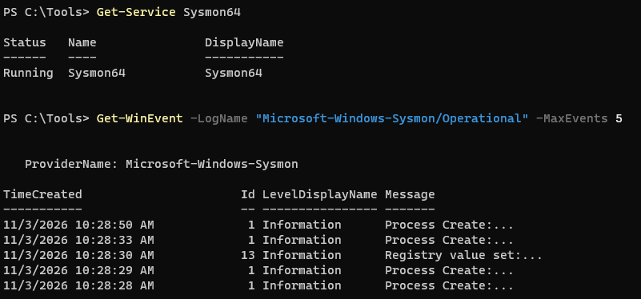
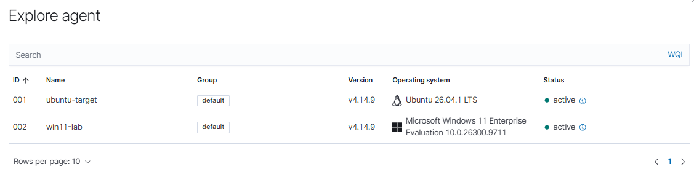
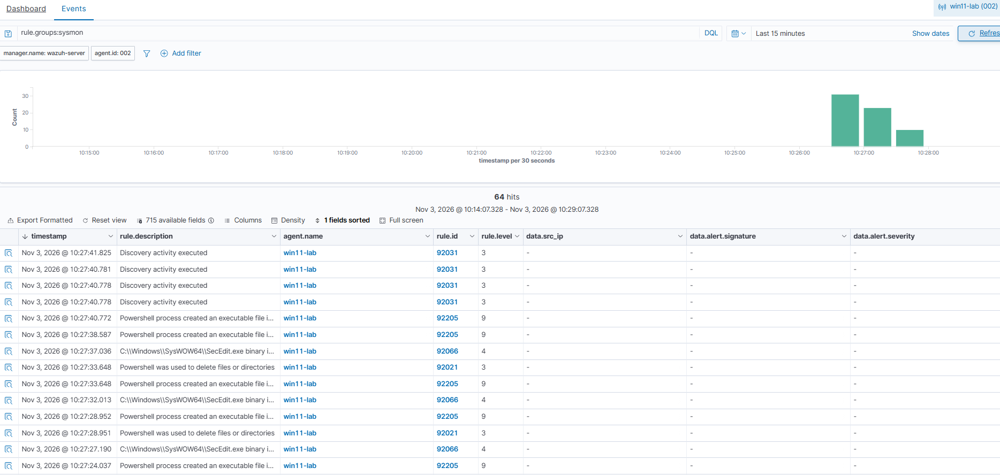
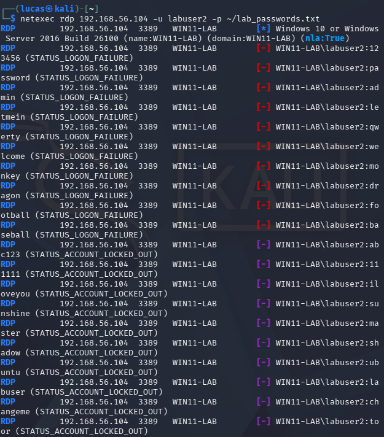
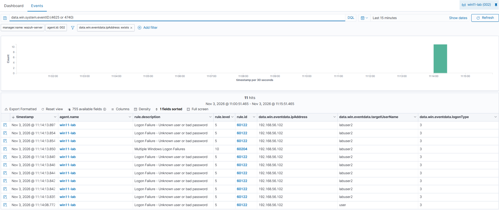
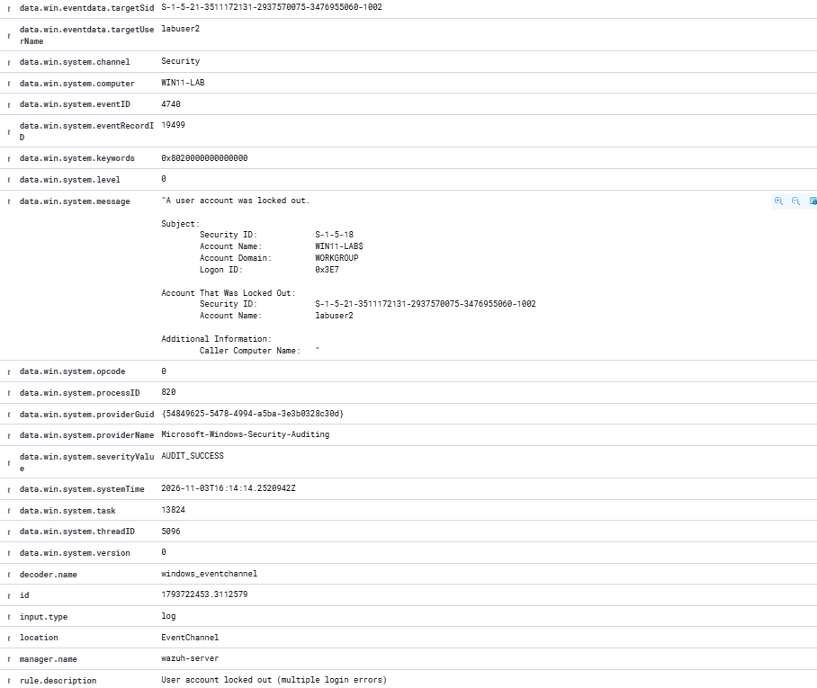
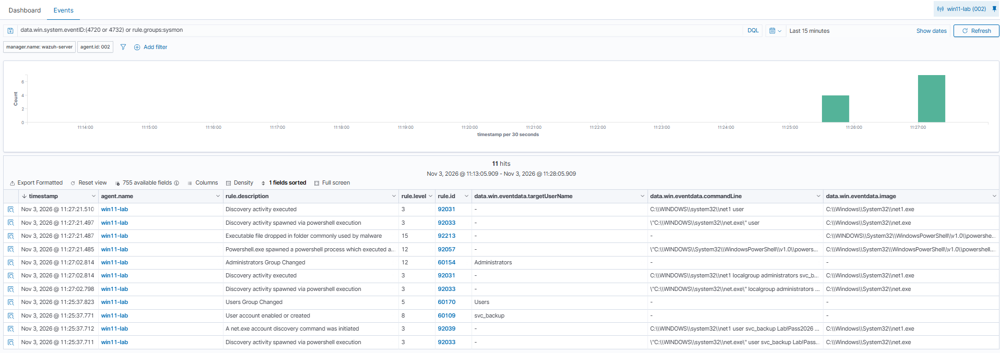
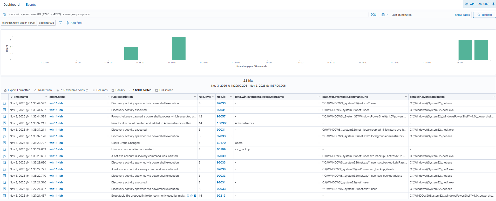
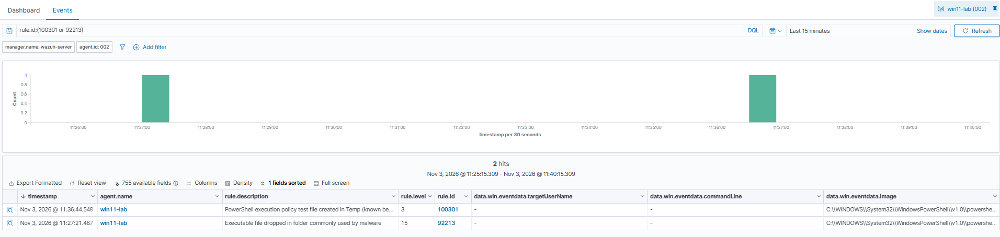

# Windows Endpoint Detection with Sysmon and Wazuh

My first three lab projects were all Linux. Most of what a SOC analyst looks at every day is Windows, so I added a Windows 11 machine to the lab, installed Sysmon for detailed logging, and connected it to Wazuh.

Then I attacked it the way a real intrusion would go: brute force RDP from Kali, then act like the attacker got in, create a backdoor admin account and run encoded PowerShell.

Two findings stood out. **The real backdoor account only got a level 8 alert, while a harmless file PowerShell creates every time it starts got a level 15**, the highest alert in the whole lab. So I wrote one rule to catch the backdoor and one to tune out the false positive.

Everything was done inside my own home lab, against my own VMs. Lab setup: [Home Lab Setup](../../home-lab/)

## Summary

- RDP brute force from Kali: **Windows locked the account after 10 bad passwords** on its own, and Wazuh raised a **level 10** for the burst and a **level 9** for the lockout
- Every failed logon (event 4625) had Kali's IP and **logon type 3**. The lockout event (4740) had **no attacker IP at all**, so it only makes sense next to the failures before it
- **Sysmon logged the backdoor account's password in plain text**, straight from the command line
- Creating the backdoor account was only a **level 8**, and Wazuh labeled the `net user /add` command as "account discovery" at **level 3**
- **False positive at level 15:** PowerShell's execution policy test file in Temp, tagged as MITRE T1105 and set to email out
- **Wrote 2 custom Wazuh rules:** 100300 raises a **level 14** when a new account gets added to Administrators within 5 minutes, and 100301 drops the PowerShell test file from 15 to **level 3**. Tested both

## Lab and tools

| | |
|---|---|
| Attacker | Kali Linux, 192.168.56.102 |
| Target | Windows 11 Enterprise (evaluation), WIN11-LAB, 192.168.56.104 |
| Logging | Sysmon v15.22 with the SwiftOnSecurity config, Wazuh agent 4.14.9 |
| SIEM | Wazuh 4.14.9, 192.168.56.103 |
| Attack tools | NetExec, net.exe, PowerShell |

Times are Florida time (UTC-5) unless they say UTC.

## 1. Setting it up

The Windows 11 VM is in VirtualBox with 8 GB RAM and 2 CPUs, on the same NAT and host-only networks as the rest of the lab. I set a static IP of 192.168.56.104 and renamed it WIN11-LAB.

### Sysmon

Windows' built-in logs miss a lot, like the full command line of every process. Sysmon is a free Microsoft tool that logs process creation, network connections, file creation and more. On its own it logs a huge amount of noise, so I used the [SwiftOnSecurity config](https://github.com/SwiftOnSecurity/sysmon-config), a well-known community config that keeps the useful events and filters the rest.

```
.\Sysmon\Sysmon64.exe -accepteula -i sysmonconfig.xml
```



### Wazuh agent

```
msiexec.exe /i wazuh-agent.msi /q WAZUH_MANAGER="192.168.56.103" WAZUH_AGENT_NAME="win11-lab"
```

By default the Windows agent sends the Security, System and Application logs. To get Sysmon too I added its channel to the agent's `ossec.conf`:

```xml
<localfile>
  <location>Microsoft-Windows-Sysmon/Operational</location>
  <log_format>eventchannel</log_format>
</localfile>
```



### The baseline

Before attacking anything I looked at what was already coming in.



64 Sysmon alerts in about 2 minutes with nothing going on, including **level 9 alerts for "Powershell process created an executable file"**. That's normal Windows activity, probably mostly from installing the agent. Good to know before the attack, so I don't mistake normal for malicious.

## 2. RDP brute force

I turned on RDP and made a test account, `labuser2`, with a password that isn't in my wordlist. Same 20 password wordlist as my other projects:

```
netexec rdp 192.168.56.104 -u labuser2 -p ~/lab_passwords.txt
```



After 10 wrong passwords every attempt came back `STATUS_ACCOUNT_LOCKED_OUT`. Windows 11 locks an account after 10 bad passwords by default, so it stopped the attack without anything like fail2ban. NetExec kept going anyway. That's the downside of lockouts: an attacker can lock real users out on purpose just by guessing wrong.

### In Wazuh

```
data.win.system.eventID:(4625 or 4740)
```



| Rule | Level | What it means |
|---|---|---|
| 60122 | 5 | Logon failure (event 4625), one per wrong password |
| 60204 | **10** | Multiple Windows logon failures |
| 60115 | **9** | User account locked out (event 4740) |

What the 4625 events showed:

- **ipAddress 192.168.56.102** on every one, Kali
- **logonType 3**, a network logon. RDP with NLA checks the password before it ever gives you a desktop, so failed attempts show up as type 3, not type 10
- **10 failures in 0.06 seconds** (11:14:13.835 to 11:14:13.897). No person types that fast
- **NTLM** as the authentication package and failure reason `%%2313`, Windows' code for unknown user name or bad password
- One failure for a user called `user` 5 seconds before the attack. Most likely NetExec testing the connection before the real run. In a real triage I'd still note it

### The lockout event has no IP



Event 4740 says labuser2 got locked out, but "Caller Computer Name" is blank and the account that did the locking is the computer itself (`WIN11-LAB$`). **Nothing in it points to Kali.** On its own the alert only tells you someone is guessing passwords, not who. To find the source you have to go back to the 4625 failures right before it.

## 3. After the break-in: backdoor account and encoded PowerShell

Next I acted like the attacker got in and wanted to keep access. Creating a second admin account is a common way to do that:

```
net user svc_backup Lab!Pass2026 /add
net localgroup administrators svc_backup /add
```

Then some recon, hidden in base64 encoded PowerShell so it isn't readable at a glance. This one just runs `whoami; hostname; net user`:

```
powershell -EncodedCommand dwBoAG8AYQBtAGkAOwAgAGgAbwBzAHQAbgBhAG0AZQA7ACAAbgBlAHQAIAB1AHMAZQByAA==
```



| Time | Rule | Level | Event |
|---|---|---|---|
| 11:25:37 | 92039 | 3 | `net user svc_backup Lab!Pass2026 /add` |
| 11:25:37 | 60109 | 8 | User account created (4720) |
| 11:25:37 | 60170 | 5 | Added to the Users group |
| 11:27:02 | 92031 | 3 | `net localgroup administrators svc_backup /add` |
| 11:27:02 | 60154 | **12** | Administrators group changed (4732) |
| 11:27:21 | 92057 | **12** | PowerShell ran a base64 encoded command |
| 11:27:21 | 92213 | **15** | Executable file dropped in folder commonly used by malware |

- **The password is right there in the log.** Sysmon records the full command line, so anyone who can read the logs can read the password. That's why passwords shouldn't go in commands, for attackers or admins
- Wazuh called the command that **created** an account "account discovery" at level 3. And the account creation event itself was only a level 8
- Adding it to Administrators (level 12) and the encoded PowerShell (level 12) did get caught

### The level 15 was a false positive

The highest alert in the whole lab was this one. I opened it up to see what file it was about:

```
TargetFilename: C:\Users\xboxuser\AppData\Local\Temp\__PSScriptPolicyTest_mkrfb51u.rns.ps1
rule.mitre.id: T1105 (Ingress Tool Transfer)
rule.mail: true
```

PowerShell creates a file like that **every time it starts**, to check the execution policy, and then deletes it. It's not an attacker downloading tools. In a real SOC this would fire constantly and get emailed out every time, and analysts would start ignoring level 15s. Meanwhile the actual backdoor sat at level 8.

## 4. The fix: two custom rules

Added to `/var/ossec/etc/rules/local_rules.xml` on the Wazuh server. Full file: [rules/local_rules_windows.xml](rules/local_rules_windows.xml)

### Rule 100300: new account added to Administrators

```xml
<rule id="100300" level="14" timeframe="300">
  <if_sid>60154</if_sid>
  <if_matched_sid>60109</if_matched_sid>
  <description>New local account created and added to Administrators within 5 minutes. Possible backdoor account.</description>
  <mitre>
    <id>T1136.001</id>
    <id>T1098</id>
  </mitre>
</rule>
```

- `if_sid 60154` - triggers when the Administrators group changes
- `if_matched_sid 60109` + `timeframe="300"` - but only if a new account was created in the last 5 minutes
- `level="14"` - higher than either event alone. Separately they're a level 8 and a level 12, together they're a textbook persistence move
- MITRE **T1136.001** Create Account: Local Account and **T1098** Account Manipulation

### Rule 100301: tuning out the PowerShell test file

```xml
<rule id="100301" level="3">
  <if_sid>92213</if_sid>
  <field name="win.eventdata.targetFilename" type="pcre2">__PSScriptPolicyTest_\w+\.\w+\.ps1$</field>
  <description>PowerShell execution policy test file created in Temp (known benign)</description>
</rule>
```

- Only matches rule 92213 when the file name is PowerShell's test file. Any other executable dropped in Temp still comes in at level 15
- Level 3, not 0. I'd rather still see it than make it disappear completely

### Testing them

I deleted svc_backup and ran the whole thing again.



**Rule 100300 fired at level 14** at 11:36:37, right after svc_backup was added to Administrators.



```
rule.id:(100301 or 92213)
```

The first run at 11:27 came in as **92213, level 15**. The second run at 11:36 came in as **100301, level 3**. Same file, same PowerShell, just rated right this time.

## Triage notes

### Backdoor admin account (rule 100300)

**Who:** Logged in user xboxuser on WIN11-LAB

**What:** Local account `svc_backup` created and added to Administrators 1 minute 25 seconds apart, followed by encoded PowerShell running recon (`whoami`, `hostname`, `net user`)

**When:** 2026-11-03, 11:25:37 to 11:27:21

**Where:** WIN11-LAB, 192.168.56.104

**MITRE ATT&CK:** T1136.001 Create Account: Local Account, T1098 Account Manipulation, T1059.001 PowerShell, T1027 Obfuscated Files or Information, T1087.001 Account Discovery: Local Account

**Severity:** High. A new admin account nobody asked for means someone may already have full control and a way back in.

**What I'd do:** Check if the account was part of an approved change. If not, disable svc_backup, reset xboxuser's password since that's the account that made it, decode and review every encoded PowerShell command from that time, and look at how the attacker got in first. Here the RDP brute force against the same machine earlier is the first place I'd look. In this case it was my own test.

### RDP brute force (rule 60204)

**Who:** 192.168.56.102 (Kali)

**What:** 10 failed RDP logons for labuser2 in under a second, logon type 3, account locked out

**When:** 2026-11-03, 11:14:13

**MITRE ATT&CK:** T1110.001 Password Guessing

**Severity:** Medium. The lockout stopped it and there was no successful logon, but the account is locked, so a real user would be locked out too.

**What I'd do:** Confirm there was no successful logon (4624) from that IP, block it, and unlock the account once the user confirms it's them. If RDP doesn't need to be reachable, close it.

## Issues I ran into

**Windows 11 wouldn't install, just a black screen.** VirtualBox showed a green turtle icon, which means Windows on my laptop was running its own hypervisor (Hyper-V) underneath VirtualBox and slowing it way down. My Linux VMs got by, but the Windows installer just sat there. It took a few things to fully turn it off: Memory integrity in Core isolation, virtualization-based security, `bcdedit /set hypervisorlaunchtype off` (which didn't stick the first time because PowerShell wasn't running as admin), and the Virtual Machine Platform feature. `systeminfo` saying "A hypervisor has been detected" was how I checked. This probably also explains why my Wazuh server was slow to start in the last project.

**VirtualBox's automatic install hung.** It swaps in its own install disc, which didn't work with this Windows ISO. I rebuilt the VM with unattended install turned off and installed it myself.

**RDP brute force showed nothing at first.** NetExec printed nothing and nmap showed 3389 as filtered. RDP was never actually turned on (`fDenyTSConnections` was still 1) and the test account didn't exist yet. Checking each piece one at a time found both.

**Columns wouldn't add in the dashboard.** The Windows fields had a "?" next to them because the dashboard's field list didn't know about them yet. Refreshing the `wazuh-alerts-*` index pattern fixed it.

**A filter hid the lockout.** I had a filter for `ipAddress: exists` on, and the lockout event doesn't have an IP field, so it disappeared from the results. Easy way to miss something during triage.

## Lessons learned

- **Severity in a SIEM isn't the truth.** The highest alert was harmless and the real backdoor was a level 8. You have to open the alert and look
- **One event rarely tells the whole story.** The lockout had no IP, the failures had no lockout. Together they make sense
- **Know your baseline first.** Windows threw level 9s before I attacked anything
- **Tune narrowly.** Rule 100301 only matches one known file name, so a real executable dropped in Temp still alerts at 15
- **Logs can leak secrets.** Command line logging is great for detection and also records any password typed into a command

## Limitations

- Rule 100300 checks that a new account was created and then an Administrators change happened on the same machine within 5 minutes, but not that it was the same account. In event 4720 the new account is in `targetSid` and in 4732 it's in `memberSid`, and I didn't find a way to compare two different fields in a Wazuh rule. Waiting longer than 5 minutes between the steps also gets around it
- Local accounts only. In a domain these would be different events on the domain controller
- One Windows machine, one attacker, and the attack ran from inside an admin session I already had

## What I'd do next

- Add a Windows Server domain controller and set up Active Directory. I did this in my [next project](../active-directory-attacks/)
- Set up Wazuh active response to block an IP after a brute force

## Next project

I built a domain controller and ran AD attacks in [Active Directory Attacks and Detection](../active-directory-attacks/).
